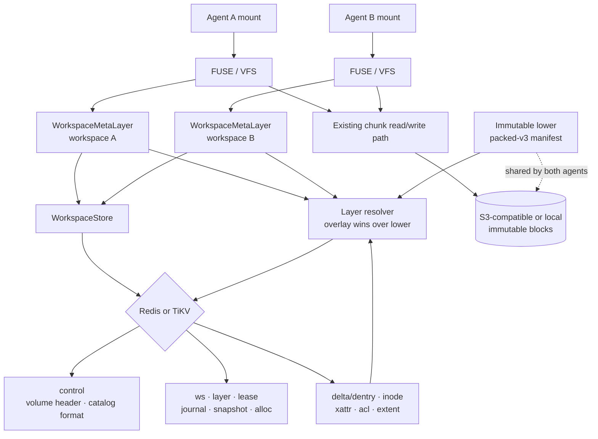
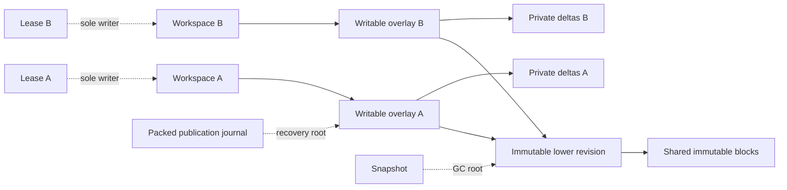
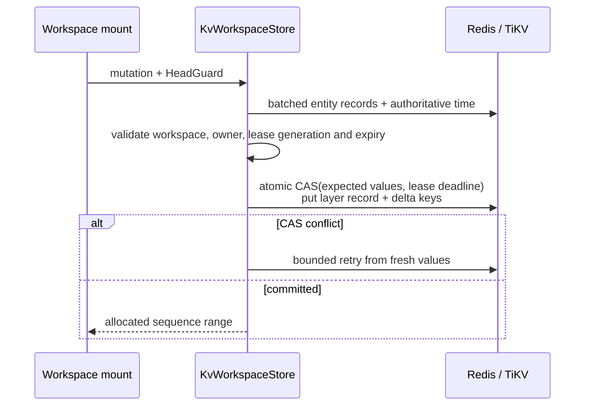

# Workspace Overlay Architecture

- Status: implemented, maintained with `src/workspace_overlay/`
- Cargo feature: `workspace-overlay` (off by default)
- Volume format: `workspace-v1`
- Catalog format: 2 (entity-key layout; `control` keeps only the volume header)
- Production metadata backends: Redis and TiKV
- Delivery baseline (2026-10-19): `0d4e36c`, PR #41, on
  `codex/packed-metadata-aliyun-20260930`.
- Model: immutable lower + non-rotating writable overlay. There is
  no seal transaction, no compaction/flatten step and no strict lower mode.

This document is the maintained architecture reference for BrewFS agent
workspaces. The detailed API, record fields, and implementation checklist
remain in the
[workspace overlay implementation spec](../superpowers/specs/2026-08-23-brewfs-workspace-overlay-implementation-spec.md).
Changes to persisted records, transaction boundaries, fencing, layer reachability,
or mount integration must update this document in the same pull request.

## Goals and boundaries

Workspace Overlay lets multiple agents share immutable lower files and object
blocks while keeping each agent's namespace, inode attributes, and data extents
private. Creating or forking a workspace from an exact revision writes metadata
records and a new empty writable overlay; it does not copy the lower or object
data.

The feature is deliberately isolated from existing BrewFS volumes:

- flat volumes continue through the existing `MetaStore -> MetaClient -> VFS` path;
- workspace volumes use `WorkspaceStore -> WorkspaceMetaLayer -> VFS`;
- the default build does not compile `src/workspace_overlay/`;
- object keys and the existing `SliceDesc` representation are unchanged;
- a workspace error never falls back to flat-volume semantics.

## The two-layer model

Every mounted view is exactly one immutable lower plus one writable overlay:

```text
writable overlay (depth 2, owned by one workspace) -> immutable lower (depth 1) -> null
```

- **Immutable lower.** A `Sealed` layer with no parent. In production it is an
  authenticated packed-v3 manifest bound to the workspace (`PackedLowerBinding`);
  the volume root created by `init-volume` is an empty lower. A lower never
  changes after it is bound, so the mount authenticates its binding once at
  attach and then serves lower inodes, permission inputs, reverse aliases and
  `(parent, name)` lookups from binding-lifetime memos.
- **Writable overlay.** The workspace's head. Its layer ID and head epoch do not
  change while a writer lease is live: no code path seals, rotates or flattens a
  mounted head. Whiteouts in the overlay stop fallback to the lower.
- **Where new lowers come from.** Only the packed publication pipeline
  (pack upload -> authenticated manifest -> binding install/publish) produces a
  new immutable lower. It runs under the single writable lease of the workspace
  it changes (see [Head changes](#head-changes-and-the-active-lease)).

Point reads batch the two exact keys into one Redis `MGET` or TiKV batch-get;
they never scan metadata. Extents are clipped and combined into a read plan
before the existing chunk reader fetches object blocks.

`statfs` does not enumerate inode deltas to synthesize effective usage. Until
Redis, TiKV, and SQLite persist usage counters atomically with each mutation,
the workspace metadata layer returns an explicit `NotSupported` error instead of
reporting zero usage or an inconsistent snapshot.

## Component architecture



## Persisted graph



Workspace heads, fork bases, snapshots, protected leases and incomplete packed
publication journals are GC roots. A layer or object slice may be deleted only
after it is unreachable from all roots and the configured lease grace period has
elapsed.

## Lease and sole-writer safety

One writable lease per workspace is the only write authority:

- `WorkspaceRecord.active_lease` is CASed `None -> Some(lease_id)` on acquire, so
  a second mount gets `Busy` while a lease is live. Release and expiry clear it;
  acquire also clears a dangling pointer to an already-invalid lease.
- Every mutation CAS checks the lease row (ID, holder generation, `Active`,
  writable), `workspace.active_lease`, the packed writer-authority and open
  records, and a backend-time deadline (`lease.expires_at_ns`). A stalled or
  fenced mount cannot commit after its lease expires, even with no other change.
- Lease expiry uses metadata-backend time, never mount-host wall time: Redis
  `TIME`; TiKV the transaction start timestamp (PD TSO physical milliseconds,
  converted with checked arithmetic); SQLite its local transaction clock.
- The heartbeat renews only its own lease. `LeaseValidity` keeps a local
  deadline (request start + TTL, extended after the joint lease/open renewal
  succeeds on packed mounts, revoked on any failure). Upper-row, namespace
  and permission caches serve only while it is authoritative and are cleared
  otherwise.
- While a packed open record is held, no other holder can take the workspace
  over, even after this mount loses its lease.

## Head changes and the active lease

No path changes `head_layer_id` or `head_epoch` of a workspace whose writable
lease belongs to someone else. Every head writer requires the caller to present
the single live writable lease of that workspace:

| Writer | Gate |
| --- | --- |
| Hot mutation (`next_sequence` only) | `checked_hot_guard` in the mutation CAS |
| `install_packed_lower_binding` / `publish_packed_lower_binding` | `checked_hot_guard` (KV) / `checked_guard` (SQLite) inside the CAS |
| Packed journal commit | exact guard equality plus committed-state revalidation |
| Initial packed bootstrap | `workspace.active_lease == guard.lease_id` |
| Native publication complete driver | `workspace.active_lease == actual.lease` in the CAS |
| Clean restore / headless recovery | original lease must be `Released`; the successor lease is the only `Active` writable lease |

Because `acquire_lease` refuses a second live lease, an administrator cannot
obtain the authority these writers need while a mount holds the workspace. The
regression test `invariant_no_head_change_under_an_active_lease` covers a
foreign holder generation, a foreign lease ID and a competing acquire.

## Transaction architecture

### Hot data path

Ordinary namespace, inode, xattr, ACL, and extent mutations never **write** the
global `control` record. They atomically check the workspace, head-layer and
lease records (plus the packed authority rows on packed mounts) and update the
head layer plus delta keys. Packed mutations also compare `control` to fence
schema migration; the non-packed hot mutation path does not read or compare it.



Because the mount is the sole writer and its head never rotates, a packed
commit can reuse its previous successful commit's exact post-commit view bytes
(`CommitViewCache`) and skip the view pre-read. The cache carries the workspace,
head, lower, lease, PWB3, writer-authority, open and CONTROL rows, plus derived
head reverse state and extent generation. Referenced slice-deletion keys may
be guessed absent, but that absence is always checked in the actual CAS.
The CAS still enforces the lease deadline in backend time. A stale comparison,
cached `Fenced`, or derived `Busy` forces a fresh read and full revalidation
within the bounded retry loop. The first commit and recovery-token commits
always read fresh. Backend uncertainty is returned, never blindly replayed.

A cached commit compares only the rows that can change while this mount
holds its lease: the workspace, head, lease, writer-authority and open
records, plus CONTROL (schema migration needs no lease). The lower layer,
PWB3 current/claim/history and recovery rows change only on paths that must
hold this workspace's single live lease, so while the lease row is
byte-identical and live, none of them ran. A change to any compared row
fails the CAS, and the retry re-reads and checks every row.

### Group commit for data writes

Every validated `MetaLayer::write` joins a per-mount FIFO queue. One leader at
a time drains up to 64 writes, then takes the mount-wide mutation gate and
commits the valid members as **one** `VersionedMutation`: one inode row per
distinct inode, folding maximum size and data-version increments in queue order
with the batch's mtime/ctime, plus each extent's visible prefix in queue order.
The unchanged row allocator advances `head.next_sequence`; extent sequences
preserve newest-wins ordering on overlap. There are no sequence reservations,
head-free commits, or fresh-slice exemptions from GC checks. A member whose
inode is gone or not a regular file fails alone. A failed batch reports the same
errno to every valid member. A write returns only after its batch has committed,
so the existing write/fsync durability boundary is unchanged.
Namespace operations (create, unlink, rename, link, setattr, open, close)
still take the gate individually.

### Extent generations and the GC slice fence

GC may delete an object slice only after reserving it
(`packed/v3/native-slice-delete/<sid>`). The reservation:

1. reads the layer inventory generation and the census of every layer;
2. reads each census layer's extent generation
   (`packed/v3/native-extent-generation/<layer>`);
3. scans the complete `delta/extent/` family and refuses if **any non-target**
   layer references the slice, even if that layer appears unreachable;
4. CASes those generations, topology/root authority and target `Deleting` rows,
   plus the slice key's absence (or exact existing reservation on retry).

Every extent birth, overwrite or deletion bumps the generation of each layer
it writes in the same CAS. Every newly written Data extent also checks that its
referenced slice has no deletion reservation.
An extent landing behind the scan cursor, after the scan passed its key
position and before the reservation CAS, bumped its layer's generation, so the
reservation CAS fails. A new layer created meanwhile bumps the inventory
generation, so it fails too. If the reservation lands first, the commit's
slice-key check fails. The scan/reservation race cannot admit both an unchecked
new reference and deletion. The regression test
`native_slice_extent_landing_behind_the_scan_cursor_blocks_the_reservation`
fails if the per-layer check is removed. The legacy volume-wide key
`packed/v3/native-extent-generation` is no longer written; reservations still
check it, so a bump by an older binary is still fenced.

Per-layer generations remove cross-workspace contention on that counter. Within one
workspace, every data commit still bumps its head layer's generation and the
head `next_sequence`; group commit amortizes both. This native slice collector
is bounded (currently 120 target layers, 4,096 scanned extent rows and 32 MiB
of scan data); exceeding its limits returns `Busy`, never a partial census.

### Lease-bound caches on the hot path

While the lease is proven held (`LeaseValidity`), these are served locally:

- upper inode/dentry/xattr rows and permission snapshots, invalidated for the
  affected keys both before and after each local commit;
- complete namespace paths and verified aliases, kept across data-only commits;
  fresh-inode creates invalidate only that inode's namespace entries, while
  other namespace changes clear the namespace cache;
- immutable lower inodes, permission inputs, reverse aliases and lookups,
  from binding-lifetime memos;
- read fences, checked against cached rows (`LeaseLocalFence`);
- a fresh inode's paths, seeded at create from the parent's cached paths (its
  only dentry is the one just written), so the first non-root open needs no
  reverse-index walk. Seeding requires the parent's complete cached paths (or
  the known root path); otherwise the normal walk runs. PR #41 adds this path
  memo, not create group commit or inode/xattr-row seeding.

Invalidation generations prevent in-flight reads from reinserting stale rows.
Losing the lease proof clears and bypasses upper/namespace/permission caches;
immutable-lower memos remain binding-scoped and cannot authorize a write or
bypass read fences. A view change clears mutable caches. The default row-cache
TTL is 60 seconds (`BREWFS_WORKSPACE_ROW_CACHE_TTL_MS`); under the lease proof it
bounds retention, not correctness. Cached permission inputs may feed a mutation,
but that mutation must still CAS its expected head and lease.

The writable layer owns its `next_sequence`, so writers in the same workspace
serialize correctly while sibling workspaces do not contend on that counter.
Native lease renewal CASes its lease row; packed mounts renew the lease and open
authority in one joint CAS. Each ID allocator CASes only its own
`alloc/<name>` record. The in-mount GC deletes orphan slices concurrently, so the
per-layer extent-generation and slice-deletion checks stay in every extent
commit.

Named dentry, inode, xattr, and ACL resolution uses exact batched reads. Prefix
enumeration is reserved for `readdir`, publication capture and GC.

### Low-frequency topology path

Fork, snapshot pinning, discard, GC, lease acquire/release and packed
publication build a read-tracked topology transaction. The store reads each
entity it needs by exact key, records the original value of every read, and runs
a pure closure that validates and modifies those entities. The check set equals
the read set, the write set is exactly the entities the closure modified, and
one multi-key CAS commits all checks and writes atomically. Retries re-execute
the closure on fresh values with bounded exponential backoff and jitter. There
is no process-global topology gate; transactions on different workspaces run in
parallel.

The catalog stores one key per entity — `ws/<workspace-id>`,
`layer/<layer-id>`, `lease/<workspace-id>/<lease-id>`,
`journal/<workspace-id>/<journal-id>`, `snapshot/<snapshot-id>`, and
`alloc/<name>`. Journal keys hold the packed publication journal only. The
`control` key holds the volume header and catalog format and is written only at
volume creation and catalog migration.

GC deletes a layer in two phases: it CAS-marks the candidate `Deleting` from the
exact value it read, rescans the root set to confirm no new root references the
layer (restoring `Sealed` on a hit), and only then deletes the delta keys and
the layer record. Root-creating operations (fork, snapshot, lease acquire,
packed publication) CAS-check the exact value of the lower layer they reference.
GC also reaps `Released`/`Expired` leases and terminal journals past their grace
period.

`initialize_workspace_schema` migrates older catalogs to the entity-key layout
(`catalog_format: 2`) with a single-key CAS. Mounting refuses an unmigrated
catalog and points at the migration command:

```text
brewfs workspace --meta-backend redis --meta-url <url> migrate
brewfs workspace --meta-backend sqlx --meta-url <url> migrate
brewfs workspace --meta-backend tikv --meta-tikv-pd-endpoints <pd-endpoints> migrate
```

Redis implements multi-key CAS with a binary-safe Lua script; all workspace keys
use one fixed cluster hash tag. TiKV uses pessimistic transactions and
`get_for_update` for the checked entity keys.

## Workspace lifecycle (CLI)

| Command | Effect |
| --- | --- |
| `init-volume` / `init-packed-volume` | Create the volume and its default workspace over an empty or packed-v3 lower |
| `create --from <revision>` | One new workspace overlay on an exact immutable revision |
| `fork <revision> --count N` | N new workspace overlays on an exact immutable revision |
| `list`, `inspect`, `diff` | Read-only views |
| `discard` | Mark a workspace `Deleting` for lease-aware GC |

There is no `workspace snapshot`, `workspace commit` or `fork <workspace-uuid>`:
each of those sealed a live workspace. Named snapshots pin an existing immutable
revision (packed publication) and are managed by the operator.

## Measured performance and remaining limits (2026-10-19)

Completed measurements of the final r31 binary (PR #41), overlay/native
files/s, from `tools/perf/run_overlay_vs_native.sh`:

| Workers | stat | full read | write | readback | mixed |
| --- | ---: | ---: | ---: | ---: | ---: |
| 1 | 1.00 | 0.71 | 0.86 | 1.06 | 1.02 |
| 16 | — | — | 0.63 | 0.91 | 0.85 |
| 32 | — | — | 0.57 | 0.88 | 0.87 |

Ratios divide arithmetic mean overlay throughput by mean native throughput.
The one-worker sweep has two repetitions, 500 files and 500 mixed operations;
16/32-worker rw measurements pool six repetitions per arm over two
order-swapped runs, with 2,000 files/operations. Workers are workload threads;
the FUSE worker pool remains 16. Stat/full files are 100 KiB;
rw files are 16 KiB, fsynced, with 30% writes in mixed mode. Both arms use the
same binary, Redis + RustFS, no compression, FUSE TTL 0/direct I/O/keep-cache 0,
no payload cache or prefetch, and the default lease-bound metadata cache.
Stat/full throughput uses the second scan epoch; setup and mount are separate.
These are specific small-file results, not a replacement for broad fio/POSIX
acceptance or evidence of TiKV performance parity.

The final sweep was interrupted during 16-worker rw; it has no final summary
or cleanup proof, and the 32-worker sweep never started. Its completed
16-worker stat/full rows give provisional 0.72/0.57, excluded from the table.
The last complete 16-worker stat/full comparison remains PR #30 at 0.75/0.57.
Earlier 32-worker stat/full results (`hot26`, before PR #29) were 0.79/0.53;
neither historical pair is a measurement of r31. The completed r31 sources
above contain 0 errors in 92 rows with matching traces/checksums and clean
teardown. Exact artifacts and reproduction commands are in the
[delivery handoff](../superpowers/plans/2026-10-17-overlay-no-seal-handoff.md).

Write remains the largest measured gap at concurrency: about 217 files/s at
16 workers and 237 at 32. Creates remain individually gated; data batches still
share the head sequence and per-layer extent generation. Combining create with
first fsync was rejected because it breaks `O_EXCL` visibility. Sequence blocks,
head-free commits, GC exemptions, create batching and full lower copy-up are
not part of the delivered design. Stat/full still pay permission/path and FUSE
read costs. `statfs` usage counters remain unsupported, and the bounded native
GC census can return `Busy`. The three baseline overlay test failures,
`source_file` flake, operator clippy failure and unverified compose smoke are
recorded explicitly in the handoff; the full feature suite is not green.

## Code map

- `src/workspace_overlay/meta_layer/`: POSIX-facing workspace metadata layer;
  `packed_lower.rs` holds the immutable-lower memos and read fences.
- `src/workspace_overlay/resolver/`: layered namespace and extent resolution.
- `src/workspace_overlay/catalog.rs`: backend-neutral storage contract.
- `src/workspace_overlay/stores/kv_store.rs`: shared Redis/TiKV state machine,
  read-tracked topology transactions, and catalog migration.
- `src/workspace_overlay/stores/kv_store/packed_journal/`: packed publication
  journal, native publication drivers and registry.
- `src/workspace_overlay/stores/redis.rs` / `tikv.rs`: backend CAS and time.
- `src/workspace_overlay/lifecycle/`: fork, discard, mount session, heartbeat
  and `LeaseValidity`.
- `src/workspace_overlay/gc.rs`: reachability and deletion.
- `src/workspace_overlay/test_base_fixture.rs` (tests only): seeds a non-empty
  flat lower for GC/diff/resolver tests.

## Required maintenance and verification

Any architecture change must preserve and test these invariants:

1. sibling workspaces share a lower but never observe each other's deltas;
2. every mounted workspace resolves exactly one immutable lower and one writable
   overlay, and no code path rotates a mounted head;
3. a second mount cannot acquire a live lease (`Busy`);
4. a commit after lease expiry or lease loss fails closed, and a held packed open
   record blocks takeover;
5. no admin path changes the head of a workspace under another holder's live
   lease;
6. hot mutations never write `control`; packed mutations compare it to fence
   schema migration;
7. same-head sequence allocation is gap-safe under backend CAS retries;
8. heartbeat and allocators remain entity-local;
9. lease-bound caches serve only while the lease is proven held;
10. active leases and incomplete publication journals prevent premature GC, and
    extent commits recheck slice-deletion reservations;
11. named point reads issue no prefix scans;
12. every topology transaction checks exactly the entities it read and touches
    no other workspace's keys;
13. default flat-volume behavior and serialized metadata remain unchanged.

The feature test suite, resolver oracle tests, real Redis/TiKV backend contracts,
dual-mount isolation tests, pjdfstest, and xfstests gates are the acceptance
evidence for this subsystem.
