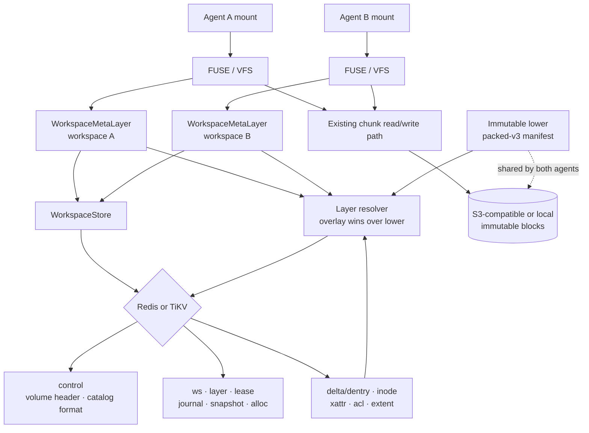
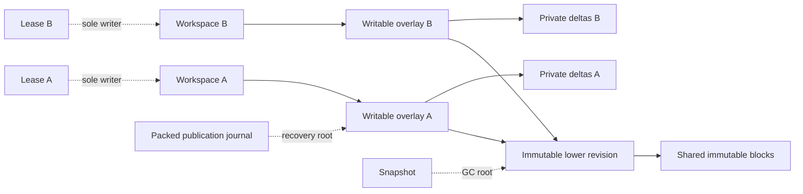
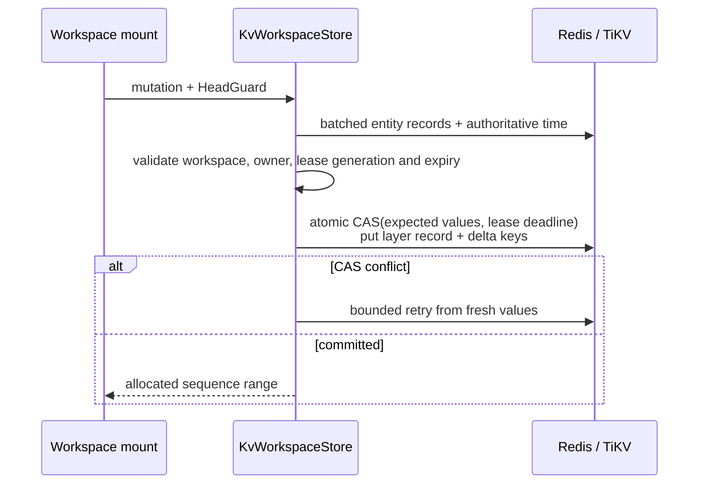

# Workspace Overlay Architecture

- Status: implemented, maintained with `src/workspace_overlay/`
- Cargo feature: `workspace-overlay` (off by default)
- Volume format: `workspace-v1`
- Catalog format: 2 (entity-key layout; `control` keeps only the volume header)
- Production metadata backends: Redis and TiKV
- Model (2026-10-17): immutable lower + non-rotating writable overlay. There is
  no seal transaction, no compaction/flatten step and no strict lower mode.

This document is the maintained architecture reference for BrewFS agent
workspaces. The detailed API, record fields, and implementation checklist
remain in the
[workspace overlay implementation spec](../superpowers/specs/2026-08-23-brewfs-workspace-overlay-implementation-spec.md).
Changes to persisted records, transaction boundaries, fencing, layer reachability,
or mount integration must update this document in the same pull request.

## Goals and boundaries

Workspace Overlay lets multiple agents share immutable lower files and object
blocks while keeping each agent's namespace, inode attributes, and data extents
private. Creating or forking a workspace from an exact revision writes metadata
records and a new empty writable overlay; it does not copy the lower or object
data.

The feature is deliberately isolated from existing BrewFS volumes:

- flat volumes continue through the existing `MetaStore -> MetaClient -> VFS` path;
- workspace volumes use `WorkspaceStore -> WorkspaceMetaLayer -> VFS`;
- the default build does not compile `src/workspace_overlay/`;
- object keys and the existing `SliceDesc` representation are unchanged;
- a workspace error never falls back to flat-volume semantics.

## The two-layer model

Every mounted view is exactly one immutable lower plus one writable overlay:

```text
writable overlay (depth 2, owned by one workspace) -> immutable lower (depth 1) -> null
```

- **Immutable lower.** A `Sealed` layer with no parent. In production it is an
  authenticated packed-v3 manifest bound to the workspace (`PackedLowerBinding`);
  the volume root created by `init-volume` is an empty lower. A lower never
  changes after it is bound, so the mount authenticates its binding once at
  attach and then serves lower inodes, permission inputs, reverse aliases and
  `(parent, name)` lookups from binding-lifetime memos.
- **Writable overlay.** The workspace's head. Its layer ID and head epoch do not
  change while a writer lease is live: no code path seals, rotates or flattens a
  mounted head. Whiteouts in the overlay stop fallback to the lower.
- **Where new lowers come from.** Only the packed publication pipeline
  (pack upload -> authenticated manifest -> binding install/publish) produces a
  new immutable lower. It runs under the single writable lease of the workspace
  it changes (see [Head changes](#head-changes-and-the-active-lease)).

Point reads batch the two exact keys into one Redis `MGET` or TiKV batch-get;
they never scan metadata. Extents are clipped and combined into a read plan
before the existing chunk reader fetches object blocks.

`statfs` does not enumerate inode deltas to synthesize effective usage. Until
Redis, TiKV, and SQLite persist usage counters atomically with each mutation,
the workspace metadata layer returns an explicit `NotSupported` error instead of
reporting zero usage or an inconsistent snapshot.

## Component architecture



## Persisted graph



Workspace heads, fork bases, snapshots, protected leases and incomplete packed
publication journals are GC roots. A layer or object slice may be deleted only
after it is unreachable from all roots and the configured lease grace period has
elapsed.

## Lease and sole-writer safety

One writable lease per workspace is the only write authority:

- `WorkspaceRecord.active_lease` is CASed `None -> Some(lease_id)` on acquire, so
  a second mount gets `Busy` while a lease is live. Release and expiry clear it;
  acquire also clears a dangling pointer to an already-invalid lease.
- Every mutation CAS checks the lease row (ID, holder generation, `Active`,
  writable), `workspace.active_lease`, the packed writer-authority and open
  records, and a backend-time deadline (`lease.expires_at_ns`). A stalled or
  fenced mount cannot commit after its lease expires, even with no other change.
- Lease expiry uses metadata-backend time, never mount-host wall time: Redis
  `TIME`; TiKV the transaction start timestamp (PD TSO physical milliseconds,
  converted with checked arithmetic); SQLite its local transaction clock.
- The heartbeat renews only its own lease. `LeaseValidity` keeps a local
  deadline (request start + TTL, extended by each successful renewal of both the
  native and packed heartbeats, revoked on any failure). Upper-row, namespace
  and permission caches serve only while it is authoritative and are cleared
  otherwise.
- While a packed open record is held, no other holder can take the workspace
  over, even after this mount loses its lease.

## Head changes and the active lease

No path changes `head_layer_id` or `head_epoch` of a workspace whose writable
lease belongs to someone else. Every head writer requires the caller to present
the single live writable lease of that workspace:

| Writer | Gate |
| --- | --- |
| Hot mutation (`next_sequence` only) | `checked_hot_guard` in the mutation CAS |
| `install_packed_lower_binding` / `publish_packed_lower_binding` | `checked_hot_guard` (KV) / `checked_guard` (SQLite) inside the CAS |
| Packed journal commit | exact guard equality plus committed-state revalidation |
| Initial packed bootstrap | `workspace.active_lease == guard.lease_id` |
| Native publication complete driver | `workspace.active_lease == actual.lease` in the CAS |
| Clean restore / headless recovery | original lease must be `Released`; the successor lease is the only `Active` writable lease |

Because `acquire_lease` refuses a second live lease, an administrator cannot
obtain the authority these writers need while a mount holds the workspace. The
regression test `invariant_no_head_change_under_an_active_lease` covers a
foreign holder generation, a foreign lease ID and a competing acquire.

## Transaction architecture

### Hot data path

Ordinary namespace, inode, xattr, ACL, and extent mutations do not read or CAS
the global `control` record. They atomically check the workspace, head-layer and
lease records (plus the packed authority rows on packed mounts) and update the
head layer plus delta keys:



Because the mount is the sole writer and its head never rotates, a packed
commit does not pre-read its view. It reuses the exact post-commit bytes of its
own previous commit (workspace, head, lower, lease, PWB3, writer-authority and
open records, CONTROL, head reverse state and extent generation) as the CAS
conditions. Each value is still compared atomically, and the CAS still enforces
the lease deadline in backend time. A value changed outside the mount (a lease
renewal, an admin fence, GC) only fails the CAS; the commit then re-reads and
fully revalidates once. The first commit after mount, and every commit made
under a recovery token, always read fresh.

The writable layer owns its `next_sequence`, so writers in the same workspace
serialize correctly while sibling workspaces do not contend. Lease renewal CASes
only `lease/<workspace-id>/<lease-id>`. Each ID allocator CASes only its own
`alloc/<name>` record. The in-mount GC deletes orphan slices concurrently, so the
native extent-generation and slice-deletion checks stay in every extent commit.

Named dentry, inode, xattr, and ACL resolution uses exact batched reads. Prefix
enumeration is reserved for `readdir`, publication capture and GC.

### Low-frequency topology path

Fork, snapshot pinning, discard, GC, lease acquire/release and packed
publication build a read-tracked topology transaction. The store reads each
entity it needs by exact key, records the original value of every read, and runs
a pure closure that validates and modifies those entities. The check set equals
the read set, the write set is exactly the entities the closure modified, and
one multi-key CAS commits all checks and writes atomically. Retries re-execute
the closure on fresh values with bounded exponential backoff and jitter. There
is no process-global topology gate; transactions on different workspaces run in
parallel.

The catalog stores one key per entity — `ws/<workspace-id>`,
`layer/<layer-id>`, `lease/<workspace-id>/<lease-id>`,
`journal/<workspace-id>/<journal-id>`, `snapshot/<snapshot-id>`, and
`alloc/<name>`. Journal keys hold the packed publication journal only. The
`control` key holds the volume header and catalog format and is written only at
volume creation and catalog migration.

GC deletes a layer in two phases: it CAS-marks the candidate `Deleting` from the
exact value it read, rescans the root set to confirm no new root references the
layer (restoring `Sealed` on a hit), and only then deletes the delta keys and
the layer record. Root-creating operations (fork, snapshot, lease acquire,
packed publication) CAS-check the exact value of the lower layer they reference.
GC also reaps `Released`/`Expired` leases and terminal journals past their grace
period.

`initialize_workspace_schema` migrates older catalogs to the entity-key layout
(`catalog_format: 2`) with a single-key CAS. Mounting refuses an unmigrated
catalog and points at the migration command:

```text
brewfs workspace --meta-backend redis --meta-url <url> migrate
brewfs workspace --meta-backend sqlx --meta-url <url> migrate
brewfs workspace --meta-backend tikv --meta-tikv-pd-endpoints <pd-endpoints> migrate
```

Redis implements multi-key CAS with a binary-safe Lua script; all workspace keys
use one fixed cluster hash tag. TiKV uses pessimistic transactions and
`get_for_update` for the checked entity keys.

## Workspace lifecycle (CLI)

| Command | Effect |
| --- | --- |
| `init-volume` / `init-packed-volume` | Create the volume and its default workspace over an empty or packed-v3 lower |
| `create --from <revision>` | One new workspace overlay on an exact immutable revision |
| `fork <revision> --count N` | N new workspace overlays on an exact immutable revision |
| `list`, `inspect`, `diff` | Read-only views |
| `discard` | Mark a workspace `Deleting` for lease-aware GC |

There is no `workspace snapshot`, `workspace commit` or `fork <workspace-uuid>`:
each of those sealed a live workspace. Named snapshots pin an existing immutable
revision (packed publication) and are managed by the operator.

## Measured performance and remaining gaps (2026-10-17)

Small-file overlay vs native files/s, 16 workers, Redis + RustFS, arms
alternated, 6 runs pooled, after PR #30 (`tools/perf/run_overlay_vs_native.sh`):

| Mode | Overlay/native |
| --- | ---: |
| stat | 0.75 |
| full read | 0.57 |
| write | 0.59 (PR #32) |
| readback | 0.79–0.81 |
| mixed | 0.86 (PR #32) |

The 32-worker rw run had 0 errors. Write is the largest gap: about three
commits per file (create, fsync, close), each a server-side Lua CAS. The
candidate next step, merging the create and first-fsync commits for a newly
created inode, is not started. Details and the resume procedure are in the
[2026-10-17 handoff](../superpowers/plans/2026-10-17-overlay-no-seal-handoff.md).

## Code map

- `src/workspace_overlay/meta_layer/`: POSIX-facing workspace metadata layer;
  `packed_lower.rs` holds the immutable-lower memos and read fences.
- `src/workspace_overlay/resolver/`: layered namespace and extent resolution.
- `src/workspace_overlay/catalog.rs`: backend-neutral storage contract.
- `src/workspace_overlay/stores/kv_store.rs`: shared Redis/TiKV state machine,
  read-tracked topology transactions, and catalog migration.
- `src/workspace_overlay/stores/kv_store/packed_journal/`: packed publication
  journal, native publication drivers and registry.
- `src/workspace_overlay/stores/redis.rs` / `tikv.rs`: backend CAS and time.
- `src/workspace_overlay/lifecycle/`: fork, discard, mount session, heartbeat
  and `LeaseValidity`.
- `src/workspace_overlay/gc.rs`: reachability and deletion.
- `src/workspace_overlay/test_base_fixture.rs` (tests only): seeds a non-empty
  flat lower for GC/diff/resolver tests.

## Required maintenance and verification

Any architecture change must preserve and test these invariants:

1. sibling workspaces share a lower but never observe each other's deltas;
2. every mounted workspace resolves exactly one immutable lower and one writable
   overlay, and no code path rotates a mounted head;
3. a second mount cannot acquire a live lease (`Busy`);
4. a commit after lease expiry or lease loss fails closed, and a held packed open
   record blocks takeover;
5. no admin path changes the head of a workspace under another holder's live
   lease;
6. hot mutations never CAS `control`;
7. same-head sequence allocation is gap-safe under backend CAS retries;
8. heartbeat and allocators remain entity-local;
9. lease-bound caches serve only while the lease is proven held;
10. active leases and incomplete publication journals prevent premature GC, and
    extent commits recheck slice-deletion reservations;
11. named point reads issue no prefix scans;
12. every topology transaction checks exactly the entities it read and touches
    no other workspace's keys;
13. default flat-volume behavior and serialized metadata remain unchanged.

The feature test suite, resolver oracle tests, real Redis/TiKV backend contracts,
dual-mount isolation tests, pjdfstest, and xfstests gates are the acceptance
evidence for this subsystem.
