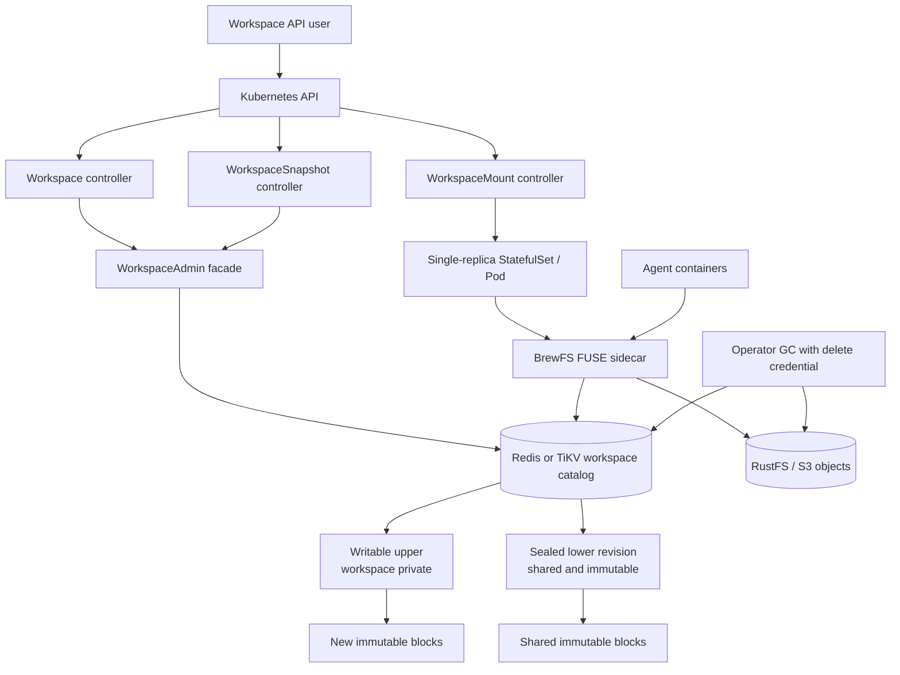
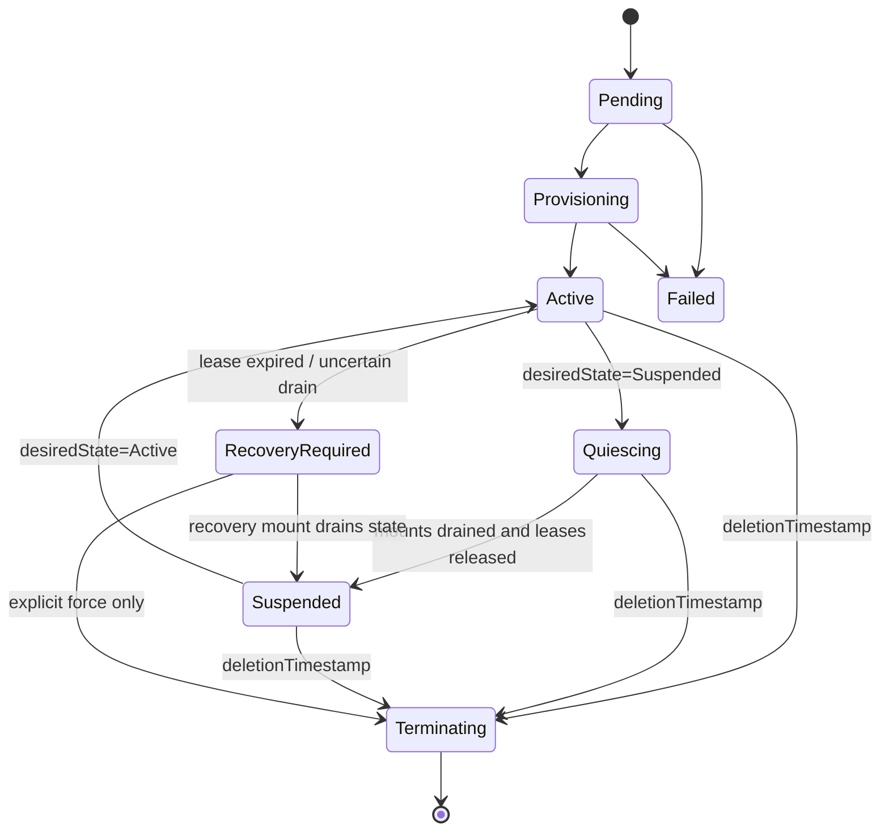
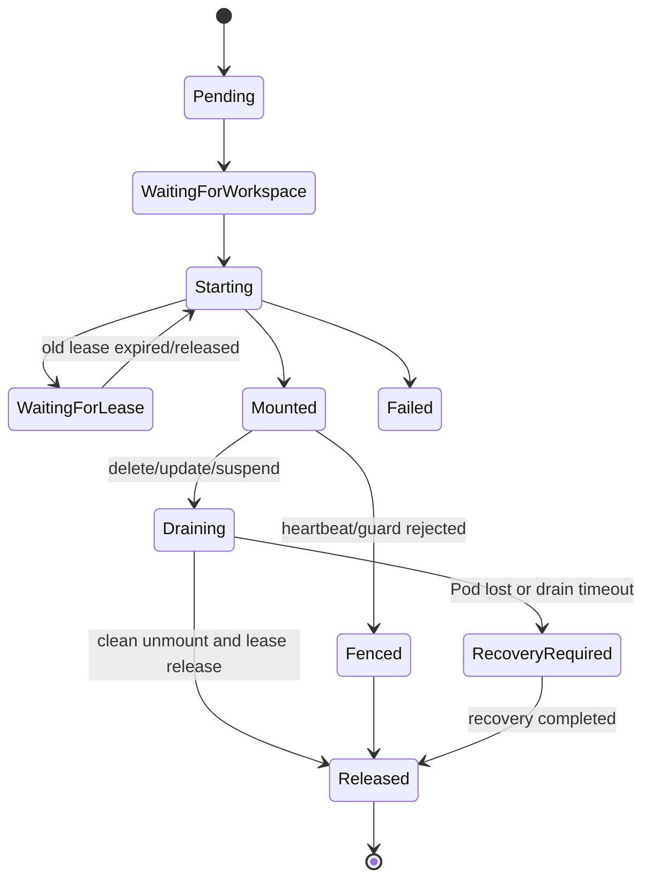

# BrewFS overlay-workspace specification

Consolidated 2026-10-20 from the workspace implementation and operator lifecycle
specifications at `cfa000af39414e14f0e0149181b92da497c1a8fb`. This consolidation
does not change implementation scope or turn an experiment into an accepted
production feature.

## Scope and precedence

The [current entity workspace contract](#current-entity-workspace-contract)
below is the live target. It defines immutable packed lower plus current-entity
upper metadata, explicit format dispatch, and the actual fresh-only experiment
boundary. The [operator lifecycle reference](#operator-lifecycle-reference)
preserves the existing `workspace-v1` control-plane design and its dated
limitations. Head/layer/CAS examples in that reference describe the older
format; they are not requirements for `WorkspaceEntityV1` and do not reopen
deferred admission, conversion, cutover or crash-takeover work.

The [packed-meta specification](packed-meta.md) owns immutable packed object
formats, authentication and read contracts. The
[workspace architecture](../../architecture/workspace-overlay.md) and dated
implementation checkpoints remain the implementation/evidence index.

## Current entity workspace contract

Updated 2026-10-20. **Status: entity experiment with opt-in benchmark mount
wiring; production mount admission remains disabled.**
This specification replaces the previous mutable-layer log design as the target
for staged implementation. The
[stage 2 checkpoint](../plans/2026-10-19-overlay-entity-stage2.md) and
[file-I/O continuation](../plans/2026-10-20-overlay-entity-data.md) distinguish
implemented APIs from the remaining production behavior below. The
[mount experiment checkpoint](../plans/2026-10-20-overlay-entity-mount.md) records
the subsequent fresh-fixture bootstrap and dedicated FUSE adapter, including
their separate validation status. No completed schema migration or qualified
production mount is claimed.

The [entity batching checkpoint](../plans/2026-10-20-overlay-entity-batching.md)
records the frozen request-cost baseline and current operation-snapshot/upload
batching refactor. Implementation and correctness gates remain in progress;
candidate command counts and throughput are pending. The paragraphs explicitly
marked as candidate behavior below do not claim validated or accepted code.

The shipped baseline remains r31, PR #41 (`0d4e36c`), with its delivery documents
in `6b54270` on `codex/packed-metadata-aliyun-20260930`. That implementation uses
an immutable packed lower and a non-rotating writable overlay, versioned extent
rows, `head.next_sequence`, an expected-head CAS, a mount-wide mutation gate,
data group commit, per-layer extent generation, and lease-bound caches. A
nonempty mutation advances its head sequence; an empty authorization need not.
This is not a full replay log: scalar inode/dentry/xattr rows are overwritten,
while data extents carry sequence-ordered history. The
[delivery handoff](../plans/2026-10-17-overlay-no-seal-handoff.md) records its
measurements, known failures and reproduction commands. The previous text of
this specification remains available at `6b54270` for interpreting that format.

The r32 prefetch/concurrent-commit experiments are **dropped, unvalidated**.
Their unfinished source is not part of this target. The prefetch full gate was
deliberately interrupted; no optimized release/probe/acceptance comparison
established a result. This is not a measured negative performance result.
Baseline diagnostic artifacts are retained in the
[WRITE investigation](../plans/2026-10-19-overlay-write-r32.md).

The maintained [architecture](../../architecture/workspace-overlay.md) describes
the same target model. The
[packed-v3 specification](packed-meta.md)
continues to define immutable packed objects, checksums, authenticated manifests
and bounded reads. Removing a mutable overlay digest does not weaken those
integrity contracts.

### 1. Target and scope

Each workspace has exactly one immutable packed lower and one ordinary mutable
metadata namespace. The upper stores the **current state** of changed entities,
as a conventional filesystem does: inode attributes, directory entries,
xattrs/ACLs and chunk-to-slice mappings. Reads check the upper first and fall
through to the pinned lower when the upper has no overriding state.

The target has no mutable layer log, global operation order, per-layer
`next_sequence`, per-commit head-version CAS, or canonical mutable-layer digest.
There is no mount-wide mutation mutex in the ordinary data/namespace path.
There is still atomicity for each POSIX operation, local ordering for conflicting
entities, lease fencing, durable object ownership and crash recovery.

There is no seal transaction, head rotation, flatten/compaction workflow or
strict-lower mode. Fork accepts an exact existing immutable packed lower;
creating a new immutable lower remains an explicit packed publication operation.
Ordinary fsync/close does not pack a workspace.

This is a staged implementation contract. The experiment defines
`workspace-entity-v1` and a bounded reference schema; it does not establish a
production wire-format promise, mounted-write admission or a throughput gain.

### 2. Required semantics and removable machinery

| Mechanism or requirement | Classification | Target treatment |
| --- | --- | --- |
| Single writable lease, backend-time expiry, stale-holder fencing | Required | Retain; every mutation validates current authority |
| Atomic create/rename/link/unlink and inode/data updates | Required | Entity transactions; lock only the affected entities |
| O_EXCL visibility before CREATE returns | Required | Commit the new inode/dentry immediately; never defer create until fsync |
| Whiteouts, holes, lower masking after truncate | Required | Explicit current-state records and a lower visibility boundary |
| Immutable packed manifest/object integrity | Required | Retain authenticated identities, checksums and reader bounds |
| Shared-object ownership, deletion exclusion and reader safety | Required | Reference counts, lower/publication owners, retirement holds and proven namespace quiescence |
| Sequence-ordered extent history and head-coupled deltas | Artifact of the old representation | Replace with the current normalized map for each chunk |
| Shared head counter and expected-head CAS on every commit | Artifact of the old representation | Remove; unrelated files have no shared mutable commit record |
| Deterministic mutable-layer digest and global ordering/replay scaffold | Artifact of the old representation | Remove; explicit stable exports are a separate operation |
| Per-layer extent generation and complete extent census before deletion | Old GC proof | Replace only after all owners use the new refcount/deletion protocol |
| Mount-wide mutation gate and generic exact-view commit packet | Old implementation machinery | Remove from the target hot path; retain entity ordering and authority checks |
| Shipped data group commit/commit-view cache, proposed create batching | Optimizations compensating for serialized commits | Not target requirements; drop during the first implementation; create batching never shipped |
| Sequence blocks, backend template stamping, r32 shared-admission adapter | Unvalidated optimization of the old representation | Drop; do not carry into the new schema |
| Lease-bound upper row/permission caches | Optional optimization | Require entity-scoped invalidation and a correct uncached path |
| Immutable lower metadata memos/prefetch | Required entity hot-path policy | Bound memory, asynchronous authenticated fills and session-retained lower ownership |
| Derived reverse aliases | Optional lookup index | Retain only when needed by operations; update atomically with their dentry |
| Recovery intent for upload, truncate, publication or deletion | Required where an operation crosses transaction/object boundaries | Bounded, idempotent lifecycle state; not a total filesystem mutation log |

The old log is unnecessary for lower sharing: the immutable lower binding is
the sharing unit. It is unnecessary for write ordering: operations affecting the
same inode/chunk serialize at their entity transaction. It is unnecessary for
lease safety: authority is a live lease record and holder identity. GC needs
proof of live owners and exclusion of new owners during deletion, not a total
sequence over every write. Diff can compare current upper state with the lower;
it does not promise historical replay or a cheap arbitrary-workspace diff. The
old scalar-row layout also did not preserve a complete operation history.

### 3. Compatibility and format boundary

`workspace-overlay` stays off by default. Ordinary flat volumes retain their
existing `MetaStore -> MetaClient -> VFS` path, schema, caches, object keys and
background jobs. Workspace volumes use the workspace adapter and explicitly
selected workspace backend. An overlay error must not fall back to flat
semantics, and a binary lacking the required feature/format must fail closed.

The existing `workspace-v1`, catalog format 2, `BaseRevision` and bincode bytes
remain definitions of the shipped format. Do not silently reinterpret those
bytes, change a hash field's meaning, or make an old binary read the new layout.
The target requires an explicit layout/capability marker and a separate upper
namespace, selected at mount. Its final wire identifier and encoding belong in
the schema change, not an undocumented reuse of an old marker.

Existing `SliceDesc` and `chunks/{slice_id}/{block_index}` object addressing need
not change. Upper records may refer to those immutable objects through a neutral
read-plan interface. The packed-v3 wire format remains authoritative for lower
object references; an old layer root hash must not be treated as a manifest
object digest.

### 4. Metadata placement and current records

Use **workspace prefixes in one volume transaction domain**, not an independent
Redis database per workspace. For Redis Cluster, all records needed by one
transaction, including shared ownership/refcount records, use the same volume
hash tag. Independent Redis DBs or cross-slot keys cannot provide the required
atomic map/refcount updates and are not part of the initial target.

The following are logical key identities, not a finalized wire encoding:

| Record | Identity | Current contents |
| --- | --- | --- |
| Workspace descriptor | workspace | Upper namespace/layout identity, immutable lower manifest binding, state, active lease identity |
| Inode | namespace, inode | Current attributes, nlink/state, lower visibility boundary, optional recovery intent |
| Dentry | namespace, parent inode, raw name | `Present(inode, kind)` or `Whiteout` |
| Chunk map | namespace, inode, chunk index | Complete normalized map of that chunk's current contents |
| Xattr/ACL | namespace, inode, raw attribute name/type | Current value or whiteout |
| Reverse alias, if required | namespace, inode, parent, raw name | Current alias, atomically maintained with its dentry |
| Slice owner membership | namespace, inode, chunk index, slice ID | One durable ownership edge for a distinct slice present in that chunk map |
| Object/slice ownership | volume, immutable object identity | Refcount, lifecycle state and durable staging/publication/retirement holds |
| Lower owner | volume, immutable lower identity, owner identity | Workspace, snapshot, reader/session or publication reference to the lower |
| Lease/open authority | workspace, holder/session | Sole writer, backend deadline, recovery/takeover fencing |
| Allocators | volume or namespace as appropriate | Plain monotonic inode/slice allocation counters |

The descriptor changes on administrative lifecycle events, lease acquisition or
release, and format/binding migration. Ordinary writes do not increment a
descriptor version, write a head record, or maintain a workspace-wide dirty
counter as a substitute serialization point. Lease renewal updates authority,
not an ordering sequence.

Names remain raw bytes with existing length, NUL and separator validation; key
encoding must be unambiguous and order-preserving where directory enumeration
needs it. Inode allocation begins above the lower's maximum inode number and
must respect the signed inode range. Slice IDs are globally unique and never
reused. Existing allocators may use ordinary `INCR`/transactional increments;
overflow fails before exposing an invalid ID. Allocation gaps are harmless.
Redis allocations respect its signed 64-bit counter limit. IDs above `2^53`
must remain exact strings/bytes through Lua and protocol handling; they must
not round through a Lua floating-point number or silently wrap/narrow.

There is no hidden claim that Redis Lua executes concurrently: Redis still
serializes scripts. Concurrent clients can overlap preparation and round trips,
and unrelated operations no longer optimistically CAS the same changing head.

### 5. Resolution rules

#### 5.1 Namespace and attributes

For `(parent, name)`, an upper `Present` wins, an upper `Whiteout` returns
not-found, and absence consults the immutable lower. Removing an override that
masks a lower name would resurrect that name; whiteouts therefore survive until
the workspace is discarded or explicitly migrated.

An upper inode contains the current effective attributes after copy-up. If it
is absent, use the lower inode. A deleted/orphan inode state is not absence and
must not expose the lower inode again. All hardlink aliases resolve to the same
workspace inode; copy-up changes the inode once and never modifies a sibling
workspace. Xattrs and ACLs use the same value/whiteout/absence distinction.

Readdir merges upper entries and lower entries by raw name, honoring whiteouts.
It uses bounded directory enumeration, not a scan of all workspace metadata.
An optional reverse-alias index is a lookup aid; forward namespace rows remain
authoritative and the index must not authorize removal of a live reference.

#### 5.2 Chunk maps

A present chunk row is the **complete current mapping** of the fixed logical
chunk range. It contains sorted, disjoint spans covering that range:

- `Data`: immutable upper slice ID, slice offset and length;
- `LowerRange`: authenticated locator into the workspace's pinned lower;
- `Hole`: explicit zero bytes, with no object fetch.

A present chunk never falls through through a missing span. A gap, overlap,
out-of-range locator or malformed map is an error, not implicit lower data.
The format may encode adjacent equal spans compactly but cannot omit their
semantic coverage. Reads are clipped to inode EOF before executing the map.

An absent chunk falls through to the lower only below the inode's
`lower_visible_size`; the rest is zero. For a lower inode this boundary starts
at the lower file size; for a newly created inode it is zero. It can only
decrease during that inode's lifetime. Extending a file never raises it.

The first write to a chunk materializes its **mapping metadata**, including
lower locators and holes, then replaces the written interval with new Data
spans. It does not copy the lower payload or the whole file. Later writes
replace intervals in the current map, removing obsolete spans; no sequence
history or newest-wins merge is needed on reads. Punch-hole/zero-range writes
Hole spans. Dropping an all-hole chunk is legal only if absence would also
resolve to zeros.

Map preparation must have explicit memory/record limits. Excessive fragmentation
cannot trigger an unbounded metadata response or silently lose spans. A future
map-page layout or payload rewrite is a separate design decision; it is not an
implicit workspace flatten/compaction operation in this target.

### 6. Transaction and concurrency contract

An operation atomically validates its authority and relevant current entities,
then changes exactly those entities and their ownership edges. Redis scripts
read/check/update the selected keys at the server; TiKV/SQLite use the equivalent
transaction. There is no generic expected-head comparison or retry based on an
unrelated file's write.

Mount-local locks cover conflicting inode/chunk/parent operations. Acquire
multiple locks in a stable order; rename may involve both parents and both
inodes. Same-parent creates legitimately share a parent update, and same-file
writes legitimately share size/map state. A local lock is not backend authority:
the transaction still fences expired leases, stale holders and deletion state.
Backend conflict handling may use current-row predicates or entity-local
versions where necessary; it must not introduce a new global commit version.

Concurrent whole-row updates must not overwrite each other's size, mode, ACL or
timestamps. A cached permission decision is valid only under the current lease
and matching entity/invalidation state; otherwise re-read and decide again.
Do not transparently retry a stale prepared inode image against newer metadata.
This includes mutable ancestor permissions on which the operation relies:
protect their decision inputs with the relevant locks or transaction checks,
not merely the final inode's cached row. Concurrent ancestor chmod/ACL changes
must not leave a stale path authorization valid.

Each operation has one visibility point. No lock is held around unrelated file
uploads or reads. Temporary admission stops for an administrative stable export,
format switch or exclusive recovery are allowed; these are not per-operation
hot-path serialization.

Initial implementation does not include group commit, speculative commit-view
caches, generic sequence templates, or reserved sequence blocks. Establish the
plain transaction behavior and measure it before adding an optimization.

Redis Lua atomic execution is not rollback on a runtime error. Validate all
input encodings, key/value types, bounds, counter overflow, reference-count
underflow and computed writes
before the first mutation. An error after an earlier SET must not leave a
partial inode/map/refcount operation. Backend-specific failure behavior must
be tested rather than inferred from the word transaction.

### 7. POSIX mutation behavior

| Operation | Required atomic result |
| --- | --- |
| Create/mkdir/symlink/mknod | Reserve a unique inode ID; atomically validate parent/type/permissions/ACL inheritance and effective name absence, install inode/dentry and update parent |
| O_EXCL create | Exactly one winner for the effective name; visibility is committed before CREATE succeeds |
| Link | New dentry and effective nlink change together; aliases retain one inode identity |
| Unlink | Whiteout/removal as required by lower presence, nlink/parent update and orphan status together |
| Rmdir | Effective upper-plus-lower emptiness and namespace mutation are ordered against concurrent children |
| Rename/replace/exchange | Source/destination, affected parents, link counts and directory-parent semantics change atomically; no partial exchange |
| Chmod/chown/xattr/ACL | Current inode/ACL relationship and privilege rules remain consistent in one transaction |
| Write/punch-hole | Current chunk map(s), inode size/times and slice-owner deltas publish together for the admitted write unit |

Create allocates with INCR inside its namespace publication transaction. It
previews the exact decimal successor to validate generated keys and collisions
before the first mutation; IDs and timestamps never round through Lua numbers.
The allocator is not a caller-side CAS predicate. An O_EXCL conflict must not
advance the counter. Unknown transport outcomes are returned without replay.
The same transaction exposes inode, name, inherited ACLs and parent updates.
All mutable validation inputs, including effective absence for O_EXCL, remain
exact predicates. Upper name absence or a canonical tombstone is required;
a present name cannot be overwritten by supplying its matching current bytes.

Create batches the five authority rows with parent/ancestor inode and ACL rows,
the destination dentry and the parent's truncate marker. A bounded advisory
parent-hint cache selects this batch; it never caches permission decisions.
The expected warm path is one read and one commit. Cold or stale topology can
require additional reads, and conflicts recalculate permissions from fresh rows.
Successful create-open retains the parent lock until the open handle is installed.

The current snapshot refactor extends the same bounded preparation mechanism to
lookup/open and data I/O. One operation reads canonical authority together with
its known entity rows into `Prepared`; namespace and data code no longer keep
separate competing read-set implementations. Parent and dentry hints each have
a 4,096-entry bound. They select rows to fetch, never authorize a permission or
prove that a name still identifies an inode. Extra discovered rows are read
only as needed, and adding a different observation for an already observed key
is a conflict. Exact observations, including absence, remain final predicates.

Candidate path open carries its observed ancestor/name predicates through inode
lock acquisition and completes one final validation instead of rewalking the
path. The attributes returned with a successful fallback open, or by truncate,
are reused for that operation's FUSE reply. This does not cache mutable
attributes across operations or permit stale permission decisions. These paths
still need the current iteration's tests and measured before/after counts.

Sticky-bit, setgid/default ACL, symlink, raw-name, special-inode/rdev and existing
lock semantics remain required. Rename cycle detection must use a stable view
of the affected ancestry; simplifying storage does not remove that POSIX check.
File locks are scoped to the workspace and inode, so siblings do not interfere.

The target's initial atime policy is explicitly **noatime**. Regular open checks
lease/permissions with zero metadata writes and retains a local handle. Linked
close releases the handle locally, including after lease expiry; neither
operation updates atime. `O_TRUNC` is still a data/metadata
mutation. Last close of an unlinked inode and orphan recovery retain durable
cleanup behavior. This policy is confined to the proposed workspace layout;
it does not alter flat volumes or claim uniform native relatime behavior.

The measured r31 WRITE path already uses `record_open`/`record_close`, not the
separate legacy atime-mutating `MetaLayer::open`. Dropping that legacy atime
path alone would not explain or fix the recorded throughput gap.

### 8. Truncate without data resurrection

A shrink must hide old upper **and** lower bytes after later re-extension.
Changing only inode size or deleting only lower extents is insufficient.

Use an inode lock and a durable `Truncating` intent:

Before publishing the cut, drain earlier buffered writes/uploads and their
metadata publications for this inode. If later implementations permit overlap,
they require an inode-scoped truncate-generation fence that rejects old upload
completions/recovery publication. Otherwise an earlier write landing after
cleanup could resurrect data. This is not a workspace-wide operation sequence.

1. Commit the new size and `lower_visible_size = min(old_boundary, new_size)`
   with the intent. This is the authoritative visible cut. Reads cannot expose
   bytes beyond the new EOF.
2. Block writes, extension and conflicting mutations of this inode until cleanup
   finishes. Other inodes continue normally. Safe reads below the cut may use
   the old maps, clipped to the current inode size.
3. In bounded transactions, remove chunks beyond the cut and replace the
   boundary chunk's suffix with Hole, updating slice-owner/refcount deltas in
   those same transactions. Advance the durable cleanup cursor atomically with
   each map/owner/refcount change; replay cannot skip rows or release twice.
4. Clear the intent only after every stale upper mapping beyond the cut is
   removed/masked. Re-extension can then expose only zeros or subsequent writes.

Recovery finishes a pending truncate before admitting mutations of that inode.
It must not clear the intent merely because the process restarted. An error
after the visible cut is an incomplete cleanup with known persistent state,
not permission to restore an old size or report success for an unperformed
extension. Fsync must durably cover the cut and its recoverable cleanup state.
The intent is bounded operation recovery, not an append-only mutation history.

### 9. Object ownership and reference counts

Object lifetime is independent of inode nlink. The ownership unit for upper
data is one distinct `(namespace, inode, chunk, slice ID)` membership. Multiple
spans of the same slice in one chunk contribute one owner; the same slice used
in two chunks contributes two. Adding/removing a hardlink does not duplicate
the chunk's data owners. Packed object/block allocation granularity must be
respected; a slice counter cannot authorize deleting a pack shared by other
live owners.

Direct sharing/reflinking of mutable upper data between two live workspace
namespaces is outside the initial scope. Sharing through immutable publication
and pinned lowers remains supported. Membership/owner accounting still handles
multiple chunks within a namespace and an upper-to-immutable ownership transfer.

When replacing a chunk map, compute old/new distinct upper-slice sets. The
metadata transaction installs the new map, adds newly required owner edges,
increments their counts, removes obsolete edges, and decrements their counts.
Edges make retries/recovery idempotent: reprocessing the same replacement must
not double-decrement or double-increment. Negative counts, missing required
owners or conflicting ownership state fail closed and require repair.

Newly uploaded data has a durable staging/orphan owner until its chunk mapping
and normal ownership commit. Failed/fenced publication leaves recoverable
orphan work, not a live mapping to missing data. No writer can reference an
object already reserved for deletion; the owner acquisition and deletion-state
check share the metadata transaction.

#### 9.1 Lower ownership

A workspace pins its whole immutable lower manifest/ownership graph. Fork adds
one lower owner and an empty upper namespace; it does not enumerate or increment
every lower inode, chunk or slice. A lower pin protects all packed objects and
borrowed immutable objects reachable through that lower's validated ownership
inventory. `LowerRange` spans rely on this pin and cannot outlive it.

Snapshots, active readers and incomplete publications have their own durable
lower owners. Removing 99 of 100 workspace owners cannot free the shared lower.
Namespace destruction releases its lower owner only after its upper references,
open handles, pending reads and recovery obligations are resolved.

The experimental SDK's trusted constructors require the packed owner's volume
and namespace IDs to match `EntityKeys`, with the same lower binding and
authoritative entity/packed backend pairing. Terminal deletion proof must come
from that same entity namespace backend. The generic lower trait checks the
manifest binding but does not enforce owner namespace identity. Enforced
production factory pairing is absent from the experiment. Standalone packed
adapter reads outside an entity session must be quiesced by their caller before
releasing the owner. The crate-private benchmark bootstrap passes one supplied
volume/namespace/binding to the existing constructors and uses the supplied
Redis URL for both adapters. This is trusted fixture wiring; it does not add
enforced backend pairing, an owner-identity hook or an external-writer check.

If publication includes upper data in a new lower, establish the new immutable
owner **before** dropping any old upper owner. Record and recover that transfer
with a bounded durable publication intent. Never briefly drive the object's
count to zero between two representations of a live reference.

### 10. GC and in-flight reads

Reference counts select candidates; deletion requires an atomic lifecycle
transition. For a zero-reference object, GC must establish that there are no
live lower/upper owners, staging obligations, publication pins or retirement holds,
then reserve `Live -> Deleting`. New owner acquisition must reject `Deleting`.
Physical deletion is idempotent; failure leaves the deletion record for retry.
Object IDs are never reused, so an old delete cannot target a later allocation.

A read can hold an old plan after another transaction replaces its chunk map.
The initial target therefore performs **physical reclamation only during proven
namespace quiescence or fenced discard**. Live writes update current refcounts
and enqueue durable retirement holds atomically with removing the last relevant
map membership. They do not delete objects merely because the current count is
zero. This protects old read plans without a distributed per-object pin request
on every read.

To release a namespace's retirement holds, stop admission, drain writes and all
active read plans/handles, and fence recoverable sessions so no old request or
recovery task can resume. Deletion still requires zero current owners and no
lower/publication/staging/retirement holds from **any** namespace. Quiescing one
namespace does not discharge another namespace's reader obligations. If an old
session cannot be proved drained/stopped, defer reclamation; lease expiry or a
fixed grace interval alone is insufficient.

The explicit tradeoff is that an active namespace retains retired bytes until
maintenance or discard. Online per-object reader pins or finer retirement
epochs may be evaluated later as a separate optimization; they are not part of
the initial target or a prerequisite extra RPC on every read.

Workspace deletion first fences new mutation, marks the namespace deleting and
resolves active leases/handles/readers. Bounded sweeps remove current entities
and release their owners transactionally. A crash resumes from recorded state;
revisiting a row cannot release an owner twice. The lower owner is released last.
GC/recovery has explicit lifecycle authority for a quiescent/deleting namespace;
it does not impersonate an expired runtime writer lease. Its authority and
checks must exclude a new mount or recovery publication during reclamation.

Namespace mark/sweep also reconciles owner edges and detects unreachable staging
or orphan records. It is a repair and cleanup mechanism, not a mandatory full
catalog scan on each write. A concurrent incomplete `SCAN` is not evidence that
an object has no owners: deletion relies on the object lifecycle fence and the
authoritative ownership protocol. Offline repair may quiesce the namespace.

The r31 per-layer extent-generation/census proof remains necessary for old-format
owners throughout coexistence. Do not remove those checks while any old writer
or old GC path can touch the same objects. Retirement occurs only after format
fencing and migration prove every remaining owner participates in the new
protocol. New refcount fields alone do not make an old census collector safe.

### 11. Lease, caches and session authority

There is one active writable lease per workspace, identified by holder/session
generation. Acquisition rejects a competing live writer. Mutation validation
checks the workspace state, namespace identity, active lease, holder generation,
required open/writer authority and backend-time expiry at the transaction's
visibility point. No host-wall-clock deadline authorizes a stale writer.

Heartbeat renews only its own authority. Local `LeaseValidity` extends only
after the authoritative renewal succeeds; failure revokes it. Lease loss blocks
new commits and clears/bypasses mutable caches. Takeover/recovery must honor
existing packed open records and reader/writeback obligations; it cannot infer
that a disconnected process has stopped using its objects.

The immutable lower is authenticated at attach and memoized by binding identity.
The entity packed adapter uses a shared 64 MiB byte-weighted LRU budget for inode,
dentry/negative-dentry, cold xattr/ACL, chunk-map and directory metadata, alongside
the packed reader's existing 4 MiB index cache. Concurrent asynchronous fills of
one key coalesce; errors are not memoized as absence. Mount warmup prefetches root
metadata and up to 32 children with four concurrent child loads, including cold
attributes and first-file-chunk maps. Cache hits use memory without metadata
network/object requests. Cold and evicted entries require authenticated fills;
neither this budget nor prefetch promises complete residency of an unbounded lower.

Binding validates the durable packed owner and exact volume, namespace, manifest,
root and maximum-inode identity against the acquired writer session. Bound hits
and fills retain local admission until completion. The same session must close
and drain before terminal lower-owner release, so per-key owner RPCs are redundant
within this bound lifetime. Unbound SDK calls retain remote owner checks. Upper
rows/tombstones take precedence at each entity key; a copied-up inode alone does
not suppress lower inheritance for an absent xattr or chunk.

Writer sessions retain the complete immutable lower binding. Runtime authority
fetches descriptor, lease, lower pin, namespace lower owner and lower registry in
one snapshot and verifies that binding has not changed. Every transaction still
checks their exact bytes and the backend-time lease deadline.

Upper inode/dentry/permission caches are separately bounded and authoritative
only under the current lease. Entity invalidation occurs before/after mutation;
an in-flight stale fetch must not repopulate a cache after invalidation.
Namespace changes invalidate the affected names, aliases and path dependencies.
Data-only writes need not clear unrelated namespace caches.

Read-plan consistency uses the affected inode/chunk lock or an equivalent local
generation validation, with lifetime protected by lower ownership and deferred
reclamation until namespace quiescence. A lower binding identity
or a lease token alone cannot detect a same-session concurrent write. No cache
may reintroduce a persisted workspace-wide version requirement.

### 12. Durability, failures and fsync

Use the existing durable data path with explicit workspace recovery identity.
Before publishing a mapping, its data must be remote durable or protected by a
proven recoverable staging protocol that can complete the upload after a crash.
Until that protocol is proven for this layout, require remote durability before
metadata publication. Local memory is never sufficient object durability.

Fsync waits for the file's required data and metadata commits and the documented
remote/durable-staging boundary; it must propagate upload, commit and lease
errors. Close must not silently discard dirty state or convert a failed commit
into success. Existing writeback recovery keys must distinguish volume,
namespace, inode, chunk and writer incarnation without altering flat-volume
keys. Packed publication always drains referenced data to remote durability.
The fsync barrier is scoped to the file, or to an explicitly documented
directory durability boundary. It is not a flush/order barrier across unrelated
workspace files and must not recreate the removed global serialization point.

The frozen measured baseline uses synchronous upload-before-publication and one
current chunk per publication transaction. The current candidate instead admits
a bounded group of chunk replacements and publishes the group's completed
prefix together. A multi-chunk write returns only its acknowledged prefix;
upload/publication uncertainty remains a session-shared file error for fsync,
including after caller cancellation or constructing another adapter. A rejected
pre-effect argument does not poison fsync. File operations retain the same
inode lock through I/O and use owned tasks once effects can begin. Ordinary
close releases a handle; it is not a durability acknowledgment for a canceled
operation, whose task and admission remain alive independently.

Candidate upload registration reuses the operation's exact authority and combines
slice-ID INCR allocation with all Pending ownership rows for the admitted group
in one transaction. Validation, generated-key checks and bounds precede the
first mutation. An ambiguous reservation does not authorize transport. Each
successful conditional durable PUT yields a local receipt bound to the exact
Pending bytes and session admission; the hot path does not persist a separate
Uploaded transition. Publication checks Pending state and new membership
absence, then installs descriptors, normalized maps, inode size/times/data
version and ownership deltas atomically. Deltas are aggregated once per slice
across the replaced chunks so shared objects do not receive overwritten or
duplicated refcount changes. Reference-count underflow and deletion exclusion
remain errors, not recoverable permission to publish.

Group preparation must respect transaction row/byte bounds and fragmented-map
limits before publication. Pending records protect uploaded objects while a
known aggregate preparation limit splits a group with fresh observations.
Uncertain commit results never trigger a split or retry. Bounded grouping is
implemented with validation pending; this specification does not claim that the
current draft already passes all partial-write cases. Unused standalone
allocation, `register_upload`, `uploaded` and singleton reservation APIs are
removed. The asynchronous membership wrapper remains for truncate/discard/orphan
cleanup and uses the same pure planner. Durable cleanup state is retained.

Candidate ordinary I/O reads the inode, truncate marker and known chunk rows in
the shared snapshot. Only a present truncate intent enters the existing bounded
recovery loop; recovery then refreshes authority and observations. Fsync retains
the FIFO inode lock, local admission and sticky-error checks. With no intent it
validates the observed inode/absence and live authority in a read-only commit;
it does not skip the durability barrier or substitute a local-only success.
No per-operation RTT reduction is considered measured until the candidate gate
and diagnostic comparison in the batching checkpoint are complete.

Strict entity PUT is a separate backend capability. S3 must support conditional creation;
the legacy OSS unconditional overwrite fallback is forbidden here. The configured
S3 durability and Redis persistence/replication policy remain external contracts.
Standalone Redis tests with persistence disabled prove transactions/replay, not
host-power-loss durability.

| Failure point | Required result |
| --- | --- |
| Upload succeeds; metadata explicitly aborts/fences | No live map references it; durable staging/orphan owner enables eventual cleanup |
| Map/refcount transaction aborts | Both old map and old ownership remain authoritative |
| Commit result is uncertain | The map may already reference the durable object; resolve using operation/entity identity or return uncertainty, never blindly replay refcount deltas |
| Crash after map/refcount commit | New mapping and its owners recover together |
| Crash during truncate | Visible cut remains authoritative; cleanup resumes before extension/write |
| Crash after GC reservation | New owners remain excluded; physical deletion resumes idempotently |
| Crash during publication ownership transfer | At least one durable owner remains until recovery completes |

Per-operation identity/recovery records are allowed where an external upload or
multi-batch cleanup needs them. They do not assign a total order to normal
filesystem mutations. The metadata backend's own crash-durability configuration
and object-store guarantees must be stated in deployment and test evidence.

### 13. Lifecycle, export and diff

Mount selects the explicit upper layout, validates its descriptor and immutable
lower, acquires the sole-writer authority, recovers pending obligations, then
admits operations. Partial mount failure releases only resources it owns.

The minimal mounted experiment is narrower than that production contract.
`entity/experiment.rs` exposes crate-private `RedisEntityExperiment` and
`ExperimentalEntityMount` wiring for an unused packed catalog and fresh entity
namespace. The CLI selects `--volume-format workspace-entity-v1` with
`--experimental-entity-mount`, a packed manifest key, a non-nil
`--entity-volume-id` and a non-nil workspace UUID. Manifest/workspace inputs
may use their existing configuration sources. `--workspace-namespace` is
optional and defaults to `brewfs`; the selected scope must be unused, and the
isolated harness supplies a fresh scope explicitly. Without opt-in, entity
mount dispatch fails closed.
The caller supplies a standalone packed graph in a dedicated experimental
object bucket and unused metadata scopes. These are fixture preconditions, not
evidence that another catalog's writers/readers have stopped.

Bootstrap uses the existing authenticated manifest/max-inode reader, creates a
private packed catalog, takes its setup lease, installs the packed lower and
acquires a source reader pin. `PackedLower::open` promotes that pin to the
existing durable lower owner for the selected volume and namespace. The source
pin is released, `Lifecycle` provisions/acquires the entity writer, and the
setup lease is released before exposing namespace/data handles. The retained
source catalog is an administrative lower root, not a shared head on the entity
write path. Uncertain failures retain protection conservatively; this wrapper
does not implement general rollback/cleanup reconciliation.

The mount renews the writer lease through the existing lifecycle API. Orderly
unmount first stops FUSE request admission and drops the adapter's handle
registry, then calls the existing session drain/maintenance transition. This
wrapper retains upper data, lower ownership and source catalog records and
provides no reopen, resume or discard operation. The isolated benchmark harness
owns teardown of its services, volumes and bucket. No crash takeover, combined
stack fault qualification, offline conversion, cutover, pairing enforcement or
production pagination is added by this wiring. Ordinary production admission
remains disabled.

Fork from an existing immutable lower creates a descriptor, empty upper and
lower owner in a bounded metadata operation. Fork from an active mutable
workspace is not introduced. Discard uses the fenced namespace-deletion process
above, never recursively deletes a shared lower, and never removes shared
object ownership solely because the originating workspace was deleted.

An explicit export/publication must quiesce the source, drain writes and walk a
stable effective namespace/map view. Ordinary Redis `SCAN` alone is not a
snapshot. Build/upload/validate packed objects using packed-v3 integrity rules,
establish the new immutable owner, then publish its descriptor/binding through
the administrative recovery protocol. No mutable-layer digest or runtime total
order is required. A checksum over the exported immutable objects remains valid
and required; it is not the removed hot-overlay root digest.

Diff compares the current namespace, attributes and normalized maps with the
pinned lower or another explicit stable export. The upper key set can identify
candidates, but a changed-then-restored record may be semantically unchanged.
Rename recognition is best effort from current aliases/inode identity; when
ambiguous, report delete+add. A consistent full diff may require a stable walk.

The target removes the shared sequence-based representation and deterministic
mutable-layer digest identity. It offers no cross-entity total order, total-order
replay or cheap arbitrary-workspace incremental diff. Upper-only changed-key
enumeration remains useful for diff candidates; a stable semantic comparison is
the general contract. The shipped scalar rows already overwrite old values, so
this is not a claim that r31 implemented a complete historical replay service.

Cheap chronological/incremental diff, total-order replay/auditing and a live
mutable-layer digest can be separate future products only with explicit cost
and semantics. They must not be recreated as a hidden global counter or log in
the write path.

### 14. Backend and VFS interfaces

Expose operations in terms of current entities and ownership, not
`VersionedMutation` templates tied to an expected layer pair. The implementation
should have bounded point reads and operation-specific atomic mutations for
namespace, inode/ACL, chunk replacement, ownership and lifecycle state.
The stage 2 `EntityBackend` provides bounded row transactions for the namespace.
`EntityData` implements current-map file operations and the existing VFS file
APIs dispatch explicitly through `EntityFileIo`. Mount admission remains a
separate qualification.

Redis is the primary implementation target, using bounded binary-safe scripts
in one volume hash slot and backend `TIME` for lease checks. TiKV must implement
the same transaction/authority contract with its transaction clock. The stage 2
local reference/fault-injection backend is `MemoryEntityBackend`; SQLite is
unimplemented and unqualified. Unsupported capabilities must fail
explicitly rather than run an unsafe partial protocol. Live Redis validation
does not imply TiKV or SQLite migration support is complete.

The current implementation uses the existing authenticated packed reader for
LowerRange and a separate current-map executor for upper Data and Hole spans.
The legacy unified provider's generation type contains head/sequence fields;
entity handles do not manufacture those fields. The explicit handle dispatch
preserves logical and object offsets, hardlinks, raw names and bounded memory.
Entity handles stay outside native inode-number indexes; unsupported fallocate
and copy-file-range handle operations fail closed. FUSE callbacks accepting live
entity handles reject them before native inode/cache/lock effects; this SDK seam
does not admit entity mounts. A separate experimental `EntityFuse` adapter
accepts the explicitly supplied entity namespace/data/root for the benchmark
mount; it does not reinterpret the SDK/native FUSE callbacks as entity-safe or
enforce production admission. Fully covered upper reads need
no lower payload fetch. Zero spans perform no object request. The ordinary flat
slice cache/compactor must not reinterpret these workspace plans.

`statfs` must use consistent persisted usage information when provided. Do not
scan an entire namespace for each call or substitute fabricated zero usage.
Until supported, retain an explicit unsupported result. Usage accounting is
not justification for reinstating a workspace-wide CAS on every write.

### 15. Experiment stages and deferred migration

Each stage has its own reviewable result. Stage 2 is now an isolated experiment
on `codex/overlay-entity-namespace-20261019` from `b6f297e`; see the
[implementation checkpoint](../plans/2026-10-19-overlay-entity-stage2.md).
The namespace, Redis transactions, packed adapter and experimental VFS file
dispatch do not admit production mounts. Stage 3 now has a minimal fresh-fixture
mount experiment, tracked in its own checkpoint. This stage is fresh-only:
importer, ownership migration and cutover are explicitly deferred. The remaining
production-admission limits below are not tasks for this benchmark stage.

1. **Preserved baseline and format boundary.** R31 code/format and accepted
   artifacts remain the baseline. Unvalidated r32 source was dropped; its
   diagnostics and incomplete gate evidence remain archived.
2. **Reference model and schema.** Current entity/map resolution and ownership
   transitions are implemented behind separate format dispatch. The stage 2
   and file-I/O checkpoints record their reference-model, metadata and service
   test coverage; those API-stage results do not qualify a production mount.
3. **Fresh-only backend/FUSE experiment: current scope.** The dedicated adapter
   uses operation-specific namespace/data APIs without old group-commit/head-CAS
   adapters. Its normal mounted probe, local gate and matched performance runs
   have their own checkpoint. This stage adds no fault-injection or broader
   production-admission work.
4. **Offline importer: DEFERRED.** No importer or adoption of existing mutable
   workspaces is implemented. The experiment bootstraps only fresh fixtures.
5. **Ownership migration/validation: DEFERRED.** No transfer from an old catalog,
   migration checkpoint or old/new semantic comparison is implemented.
6. **Atomic cutover/rollback: DEFERRED.** There is no descriptor format switch,
   migration recovery or reverse export. **After new-format writes, pointer
   rewind would lose data.** This experiment provides no rollback to r31.
7. **Production qualification and retirement: DEFERRED.** Enforced pairing,
   external crash-takeover authority, paginated production cleanup, full
   mounted/POSIX qualification and retirement of old owners remain limitations.
   The experiment leaves existing ownership and legacy code in place.

The schema/namespace selector is administrative identity, not a new hot head
version. Migration journals/checkpoints and exported-object checksums do not
restore a global runtime mutation log or digest.

### 16. Validation and performance evidence

New object-I/O tests use the production `S3Backend` against an isolated RustFS
service through `entity/test_objects.rs`. The helper requires an explicit
loopback `BREWFS_PACKED_GRAPH_TEST_S3_ENDPOINT`, a UUID-named isolated
`BREWFS_PACKED_GRAPH_TEST_S3_BUCKET`, and runner-provided AWS credentials;
Redis integration also requires `BREWFS_TEST_REDIS_URL`. It disables mutation
replay and gives fixtures unique object keys in the runner-owned bucket.
Memory metadata backends provide deterministic transaction/fault injection;
local temporary directories are limited to producer metadata spools. LocalFS
does not supply the new entity durability capability or its object-I/O evidence.
Service tests are ignored by default and must run with `--include-ignored` in
the real-service gate. Selecting them without configuration fails explicitly.
The RustFS/Redis gate passed six packed-lower, 78 entity and two VFS tests at its
recorded API-stage source snapshot, with zero failed or ignored in those
selected suites. The
[file-I/O continuation](../plans/2026-10-20-overlay-entity-data.md) records the
source snapshot, exact commands, artifacts and remaining qualification gaps.
Those results do not validate the subsequent bootstrap or dedicated FUSE
adapter; their checks and mounted probes are tracked in the mount checkpoint.

The recovery fault oracles exercise metadata and simulated byte/deletion
state; separate RustFS fixtures exercise object requests. Packed-lower tests
use memory entity metadata even when their packed owner/census is in Redis;
Redis entity data/VFS tests use a synthetic lower. This is not qualification of
the combined Redis entity, real packed lower and VFS stack, physical packed
graph retirement, or process/host crash recovery. Local maintenance tokens
prove a drain in the surviving process only. External process-takeover
authority remains unimplemented, and lease expiry alone cannot supply it.

The following target requirements remain unqualified as a complete production
stack. They describe known limits, not additional tasks for the current
fresh-only benchmark stage:

- two siblings share lower bytes but isolate create/write/chmod/rename/unlink;
- concurrent O_EXCL has one winner, same-file size/maps retain all valid writes,
  and unrelated creates/writes do not wait on one mount-wide metadata gate;
- holes and shrink/re-extend never expose old lower or old upper bytes;
- a crash at every truncate stage completes cleanup before mutation resumes;
- lease expiry/loss, stale generation, takeover and admin changes fail closed;
- cached ACL/permission decisions cannot survive a conflicting mutation;
- map/owner/refcount updates abort and recover atomically, including uncertain
  replies and retries without duplicate increments/decrements;
- a new owner racing `Live -> Deleting` wins before reservation or fails after
  it; active readers and delayed read plans retain objects until all relevant
  namespace retirement holds can be released under proven quiescence;
- 100 children keep a shared lower alive after 99 deletions, and publication
  never leaves an ownership gap for borrowed upper objects;
- namespace/migration cleanup resumes without double-release, and old collectors
  cannot delete objects visible through the new layout;
- fsync/restart and a real mount verify durable payloads and namespace state;
- default flat behavior, feature isolation, backend contracts, POSIX and the
  repository's required fmt/clippy/build/test gates remain valid.

Future performance acceptance uses matched compose runners and preserved executables.
Measure 16 and 32 workers with arm order swapped; report overlay and native
files/s, sample counts/spread, raw and normalized deltas, errors and teardown.
Retain readback/mixed correctness and latency, object amplification, fsync/close
and writeback-debt checks. Broader randrw/metadata and flat regressions remain
gates. Diagnostic logging/profiling is separate from acceptance measurements.
Do not interpret overlapping concurrent hold timers as exclusive occupancy.
Those broader acceptance requirements are deferred for the current experiment.
Its scope is one minimal smoke per available arm, then WRITE/READBACK at
1/16/32 workers in opposite arm orders using Redis and RustFS. The requested
arms are native, entity over frozen native, and entity over packed-v3; a missing
arm is explicitly skipped with no substitute.

The [mount checkpoint](../plans/2026-10-20-overlay-entity-mount.md) records all
24 completed available phase rows, zero workload errors, two samples per cell
and clean smoke/teardown evidence. Preliminary packed-overlay WRITE medians
at 1/16/32 workers were 20.08/111.90/135.00 files/s, versus native
51.63/351.03/419.83. READBACK medians were 32.04/173.05/199.05, versus native
113.40/602.50/616.47. `overlay-native` was skipped because its entity-compatible
native lower adapter, binding and mount bootstrap are missing. These results
measure newly created upper bytes; they are not lower-read/copy-up or
acceptance results and do not establish a win or removal of the write plateau.

The later frozen, instrumented-source baseline has a separate uninstrumented
2,000-file comparison in the [batching checkpoint](../plans/2026-10-20-overlay-entity-batching.md).
Its preliminary 16/32-worker WRITE medians are 114.513/140.819 entity versus
358.388/448.404 native files/s; READBACK is 176.612/205.422 versus
637.359/685.946. These are baseline observations, not candidate results. The
200-file diagnostic reports roughly 114 external Redis commands per WRITE file
and 76 per READBACK file, versus native 7.11 and 5.00 at 16/32 workers. Native
command totals include pipelined commands and are not native network RTT counts;
entity request/reply spans are reported separately. Entity inode-lock waits are
negligible in that workload; repeated metadata request/validation work is the
measured cost. The initial 16-worker MONITOR capture was interrupted and excluded;
completed 1-worker phases and the complete 16/32 retry retain separate provenance.
All candidate validation, command-count deltas and throughput rows remain pending.

Historical **r31**, not target-design, overlay/native ratios are:

| Workers | Stat | Full read | Write | Readback | Mixed |
| --- | ---: | ---: | ---: | ---: | ---: |
| 1 | 1.00 | 0.71 | 0.86 | 1.06 | 1.02 |
| 16 | Unverified | Unverified | 0.63 | 0.91 | 0.85 |
| 32 | Unverified | Unverified | 0.57 | 0.88 | 0.87 |

The completed 16/32-worker WRITE means were 216.892/236.892 overlay versus
344.005/414.744 native files/s (six runs per arm/worker). The final all-mode
sweep was interrupted; its partial stat/full rows are not completed acceptance.
Known baseline feature-test failures and flaky/source/operator checks remain
documented in the handoff. Neither those historical gates nor the r32 partial
gate validate this target design. **The entity measurements above are preliminary;
there is no target-design performance acceptance result.**

### 17. Remaining tradeoffs and delivery boundary

Current chunk maps trade sequence-history read merging for map replacement cost and
potential fragmentation limits. Same-inode and same-parent contention remains
legitimate; plain allocators and Redis's single-threaded script execution still
have finite capacity. Shared-object refcounts introduce object-local contention
when many entities share the same object. Lower pins retain whole lower
ownership until the last owner is gone, which can delay reclamation of bytes
unused by a particular workspace.

Offline migration is deferred and has no implementation in this stage. Live
namespaces retain retired bytes until quiescent
maintenance/discard, which deliberately trades reclamation latency for a simple
read path. Complete quiescence and crash-safe owner accounting are not qualified
for production.
The target deliberately gives no cheap arbitrary-workspace incremental-diff or
total-order-replay contract and removes live mutable-layer digest identity.
Upper-only diff candidates remain available. These are explicit tradeoffs;
they do not assert that the shipped layout was a complete replay log.

The stage 2 experiment adds separately dispatched `workspace-entity-v1`
namespace and file APIs. Packed ownership joins the existing collector census;
entity writes use current maps and strict durable uploads, and truncate has a
replayable inode-local intent. The experimental VFS handle path keeps entity
handles out of native inode indexes and rejects unsupported handle operations.
Only the explicit fresh-fixture benchmark opt-in can select the dedicated
entity mount adapter. Production mounts remain disabled. External
crash-takeover authority, enforced backend/owner pairing, production pagination,
full mounted/POSIX qualification and conversion remain known limitations.
These correctness gates are not performance acceptance.

## Operator lifecycle reference

**Historical `workspace-v1` operator contract, last revised 2026-10-17.** The
CRDs, reconciliation/status rules, finalizers and operational examples below
are retained because existing old-format workspaces and their operator code
remain separate from the entity experiment. They do not claim entity-format
operator support, new mount admission, or successful completion of the listed
integration/failure tests. The current entity contract above takes precedence
where the representations differ. “Current”, “this phase” and “future” in this
reference retain their original dated meaning.

2026-10-04当前任务仅v3及其workspace生命周期。v3 capability/binding、lease/fence、
finalizer/recovery/GC和真实后端验收仍必需；旧flat/CR/存储格式兼容移出出口。以
[当前v3目标](../plans/2026-10-04-brewfs-all-spec-completion.md)为范围依据。

- 状态：Draft
- 日期：2026-09-03
- 目标版本：`storage.brewfs.io/v1alpha1`
- 适用后端：Redis、TiKV
- 依赖能力：`workspace-overlay` / `workspace-v1`

### 2026-10-17 模型更新

workspace 模型为 **不可变 lower + 不轮转的可写 overlay**：

- 不存在 seal 事务：operator 不再封存 native workspace，`WorkspaceAdmin::seal_and_snapshot`
  已删除；
- `BrewFSWorkspaceSnapshot` 只对 packed workspace 生效（pin clean packed snapshot、发布或
  恢复 packed publication）；native workspace 的 snapshot 请求进入 `Failed`，消息为
  “snapshots require a packed-v3 workspace; native workspaces are never sealed”；
- mount 期间 head 不轮转；改变 head 的 packed publication 必须持有该 workspace 唯一的
  active writable lease（见 workspace overlay 实现规范 §15.3）；
- mount 启动不再执行 seal recovery（`recover_incomplete_seals` 已删除）。

下文旧的 native seal 流程已按此更新；冲突处以本节为准。

### 1. 目的

本规范定义 Kubernetes 场景下 BrewFS workspace 的声明式管理方式，作为后续 CRD、controller、挂载工作负载和测试代码的实现依据。

设计重点是：

1. 把逻辑 workspace、运行时挂载和不可变快照拆成独立生命周期；
2. 保证任意 agent 的写操作只能进入自己的 writable upper layer；
3. 保证一个 workspace 当前引用的不可变 lower revision 不会被挂载进程、其他 workspace 或 GC 原地修改；
4. 正确处理 Pod 重启、节点故障、operator 重启、lease 过期、packed publication 中断和资源删除；
5. 不改变现有 `BrewFSCluster` / `BrewFSMount` 的 flat-volume 行为；
6. Redis 和 TiKV 使用完全一致的状态机语义。

本文只定义实现方案，不包含与其他系统的对比。

### 2. 范围与非目标

#### 2.1 本期范围

- 扩展 `BrewFSCluster`，使其能够初始化并声明一个 `workspace-v1` volume；
- 新增 `BrewFSWorkspace`；
- 新增 `BrewFSWorkspaceMount`；
- 新增 `BrewFSWorkspaceSnapshot`；
- 管理 workspace 的 create、mount、suspend、resume、snapshot（packed）和 delete；
- 管理 mount lease、holder generation、优雅 drain 和异常 fencing；
- 用 finalizer 保护 mount、workspace、snapshot 和 cluster 的删除顺序；
- 为 agent workload 生成单 workspace、单 writable mount 的 Pod/StatefulSet；
- 为 lower metadata、lower object blocks 和 GC root 提供不可变保护；
- 为上述流程提供 status conditions、Events、metrics 和端到端测试。

#### 2.2 非目标

- 不在本期实现 CSI controller/node plugin；
- 不允许同一个 workspace 同时存在多个 writable mount；
- 不支持 workspace mount 的 DaemonSet 或 `replicas > 1`；
- 不自动修改用户已有的 Deployment/StatefulSet；
- 不自动执行跨 workspace merge；
- 不在本期把 commit/publish 暴露成 Kubernetes API；
- 不支持 etcd workspace catalog；
- 不改变 flat-volume 的 metadata、mount 或 GC 路径；
- 不防御拥有 Redis/TiKV/S3 管理员权限的基础设施管理员。这里的不可变保证覆盖 Kubernetes tenant、agent workload 和正常 BrewFS runtime；基础设施管理员属于信任边界之外。

#### 2.3 Packed lower 的后续能力边界（2026-10-03 review）

本文baseline仍是 `workspace-v1` 与精确sealed `BaseRevision`；新增
[packed-v3 SPEC](packed-meta.md)
的readonly mount不代表operator已有packed lower support。当前binding/head-CAS/
recovery/GC尚未接通，不能只把manifest key塞进现有revision字段就置Ready。

未来集成需明确capability和独立版本化binding，比较固定manifest content digest与
head/generation，保留旧BaseRevision/CR外部编码兼容；unsupported/missing/corrupt binding
返回失败condition，不回退native/KV语义。Kubernetes Ready/Pod Ready不构成对象graph
closure、source一致性、durable publish或read fence证据。finalizer/leases/journals/GC
须保护全部可达index/container/descriptor/cold/large objects和仍被pin的旧manifest。

本期“不暴露commit/publish为Kubernetes API”仍有效；packed原子发布属于单独后续扩展，
不能通过修改本规范把未实现控制面默认为已支持。

### 3. 核心设计决策

#### 3.1 保留现有两层 Operator

现有资源继续保持原职责：

- `BrewFSCluster`：管理 Redis、RustFS、配置和 workspace volume bootstrap；
- `BrewFSMount`：只管理现有 flat-volume 挂载。

workspace 不通过给 `BrewFSMount` 增加大量条件分支来实现。新增 controller 和模块必须通过独立 Cargo feature 编译，避免影响原有 operator 路径。

#### 3.2 新增三个 workspace 资源

1. `BrewFSWorkspace`
   - 表示一个长期存在的逻辑 COW workspace；
   - 在后端对应一个稳定的 `workspace_id`；
   - 即使挂载 Pod 被删除或重建，workspace 身份和 upper layer 仍然保留。
2. `BrewFSWorkspaceMount`
   - 表示一次可重建的运行时挂载；
   - 负责 FUSE sidecar、agent containers、lease 和本地 writeback 状态；
   - 同一 workspace 最多一个 writable mount。
3. `BrewFSWorkspaceSnapshot`
   - 表示一个由后端 `SnapshotRecord` 固定的精确 `BaseRevision`；
   - 是 lower layer 的声明式、不可变引用和 GC root；
   - Ready 后 spec 和 revision 均不可改变。

#### 3.3 lower 不是可写 Kubernetes volume

workspace lower 不会作为一个单独的 hostPath/PVC 暴露给 Pod。agent 只看到一个统一的 FUSE mount：

- upper 命中时读取 upper；
- upper 未命中时读取 sealed lower；
- 所有 mutation 通过 `HeadGuard` 写入 writable upper；
- lower layer ID 从不作为 mutation target。

因此 `readOnly: true` 不是 lower 不可变性的主要机制。不可变性必须由 workspace metadata 状态机、COW object 写入和权限隔离共同保证。

#### 3.4 一个 mount 始终只有两层

每次可用挂载必须满足：

```text
writable head (depth=2, owner_workspace_id=<workspace>)
  -> sealed base (depth=1, owner_workspace_id=None)
  -> null
```

不存在 seal。唯一允许切换 lower 的是 packed publication：它在持有该 workspace 唯一 writable lease 的前提下，以一次 CAS 安装/发布新的 packed lower binding；旧 lower 永远不原地修改。挂载中的 mount 不会看到 head 被其他 holder 改变。

### 4. 总体架构



controller 通过一个 backend-neutral `WorkspaceAdmin` facade 操作 workspace catalog，不允许通过 shell 调用 CLI 并解析日志。Redis/TiKV 差异只存在于 `WorkspaceStore` 实现中。

### 5. Cargo 与代码隔离

operator 新增 feature：

```toml
[dependencies]
brewfs = { path = "../..", default-features = false, optional = true }

[features]
default = []
workspace-operator = ["dep:brewfs", "brewfs/workspace-overlay"]
```

建议代码布局：

```text
operator/brewfs-operator/src/
├── crd.rs                         # 现有 flat CRD，保持兼容
├── reconciler.rs                  # 现有 flat controller，保持兼容
└── workspace/
    ├── mod.rs
    ├── crd.rs
    ├── admin.rs                   # WorkspaceAdmin trait/backend factory
    ├── cluster.rs                 # workspace volume bootstrap
    ├── workspace_controller.rs
    ├── mount_controller.rs
    ├── snapshot_controller.rs
    ├── workload.rs                # sidecar/StatefulSet/PVC builder
    ├── finalizer.rs
    ├── status.rs
    └── tests.rs
```

编译约束：

- 未启用 `workspace-operator` 时，不编译上述模块和三个新 controller；
- 现有 `BrewFSCluster` 和 `BrewFSMount` 的序列化结果不得变化；
- 普通 BrewFS binary 的 `workspace-overlay` feature 仍默认关闭；
- workspace runtime 镜像必须显式包含 `workspace-overlay`。

### 6. `BrewFSCluster` 扩展

#### 6.1 Spec

```yaml
apiVersion: storage.brewfs.io/v1alpha1
kind: BrewFSCluster
metadata:
  name: demo
spec:
  redis: {}
  rustfs: {}
  workspace:
    enabled: true
    catalogBackend: Redis       # Redis | TiKV
    namespace: brewfs-demo
    leaseTtlSeconds: 30
    heartbeatSeconds: 10
    gcGraceSeconds: 60
    catalogStorageSize: 5Gi   # Operator-managed Redis catalog only
```

新增 `WorkspaceClusterSpec`：

| 字段 | 类型 | 默认值 | 约束 |
|---|---|---:|---|
| `enabled` | bool | false | false 时不创建 workspace catalog |
| `catalogBackend` | enum | Redis | 仅 Redis/TiKV |
| `namespace` | string | `<cluster namespace>-<cluster name>` | 创建后不可变，必须通过 DNS/key-prefix 校验 |
| `leaseTtlSeconds` | u32 | 30 | 10..300 |
| `heartbeatSeconds` | u32 | 10 | 必须小于 TTL/2 |
| `gcGraceSeconds` | u32 | 60 | 必须大于等于 lease TTL |
| `catalogStorageSize` | Quantity string | 5Gi | Redis catalog PVC 容量，不能为空 |

#### 6.2 Bootstrap

cluster controller 必须执行幂等 bootstrap：

1. 等待 Redis/TiKV 和 RustFS Ready；
2. 建立 workspace catalog 连接；
3. 检查 `VolumeHeader`；
4. 若不存在，使用由 `BrewFSCluster.metadata.uid` 派生的确定性 UUID 创建：
   - `volume_id`；
   - root workspace ID；
   - root sealed layer ID；
   - root writable layer ID；
5. 若已经存在，严格核对 volume ID、format、schema version 和 cluster UID annotation；
6. 为初始 sealed revision 创建由 cluster UID 派生的确定性 SnapshotRecord，使其成为 cluster root GC root；
7. reserved root workspace 不允许被普通 Mount CR 引用；
8. 将初始 sealed revision 固定为 cluster root revision；
9. 将精确 revision 和 cluster root snapshot ID 写入 status。

不得在重试时创建第二个 volume root。若相同 namespace 已被另一个 cluster 初始化，phase 必须为 `Conflict`，不得接管。

#### 6.3 Status

```yaml
status:
  workspace:
    volumeId: "..."
    schemaVersion: 1
    catalogBackend: Redis
    catalogNamespace: brewfs-demo
    rootSnapshotId: "..."
    rootRevision:
      layerId: "..."
      sealedVersion: 1
      rootHash: "..."
  conditions:
    - type: WorkspaceCatalogReady
      status: "True"
```

### 7. `BrewFSWorkspace` CRD

#### 7.1 Spec

```yaml
apiVersion: storage.brewfs.io/v1alpha1
kind: BrewFSWorkspace
metadata:
  name: agent-42
spec:
  clusterRef:
    name: demo
  source:
    kind: Snapshot             # ClusterRoot | Snapshot
    name: repo-main            # ClusterRoot 时省略
  desiredState: Active         # Active | Suspended
  ownerId: agent-42
  deletionPolicy: Delete       # Delete | Retain | SnapshotAndDelete
```

字段语义：

| 字段 | 是否可变 | 说明 |
|---|---|---|
| `clusterRef` | 否 | 同 namespace 的 `BrewFSCluster` |
| `source` | 否 | 只能解析为精确 `BaseRevision`，不接受“workspace latest” |
| `desiredState` | 是 | Active 允许 mount；Suspended 要求所有 mount 完成 drain/release |
| `ownerId` | 否 | 写入 backend workspace owner |
| `deletionPolicy` | 删除前可变 | 删除开始后冻结 |

CRD 必须使用 CEL 校验 `clusterRef`、`source` 和 `ownerId` 的不可变性。
Snapshot source 必须与目标 Workspace 引用同一个 `BrewFSCluster`，禁止跨 catalog/volume 引用 revision。

#### 7.2 确定性身份

`workspace_id` 不由每次 reconcile 随机生成：

```text
workspace_id = UUIDv3(cluster volume_id, BrewFSWorkspace.metadata.uid)
initial_head_layer_id = UUIDv3(workspace_id, "head/0")
```

后端需要新增幂等 `ensure_workspace` primitive：

- 记录不存在：创建；
- 记录存在且 workspace ID、base revision、owner 和 initial head 完全相同：成功；
- 任一字段不同：`Conflict`，不得覆盖。

status 只是后端状态的缓存，controller 重启后必须能通过确定性 ID 从 backend 恢复，不得依赖旧 status 才能继续。

#### 7.3 Status

```yaml
status:
  observedGeneration: 3
  phase: Active
  workspaceId: "..."
  originRevision:
    layerId: "..."
    sealedVersion: 7
    rootHash: "..."
  currentBaseRevision:
    layerId: "..."
    sealedVersion: 8
    rootHash: "..."
  headLayerId: "..."
  headEpoch: 4
  activeMountRef: agent-42-mount
  lastCleanReleaseEpoch: 4
  conditions: []
```

`originRevision` 在资源整个生命周期内不变；`currentBaseRevision` 只会在 packed publication 成功后改变。

#### 7.4 Phase



`phase` 是粗粒度展示；自动化判断必须使用 `conditions` 和 backend state。

#### 7.5 Conditions

至少实现：

- `Ready`
- `SourceResolved`
- `BaseVerified`
- `MountActive`
- `Quiesced`
- `RecoveryRequired`
- `DeletionBlocked`
- `Degraded`

每个 condition 必须包含 `status`、`reason`、`message`、`observedGeneration` 和 `lastTransitionTime`。语义未变化时不得刷新 `lastTransitionTime`。

### 8. `BrewFSWorkspaceMount` CRD

#### 8.1 Spec

```yaml
apiVersion: storage.brewfs.io/v1alpha1
kind: BrewFSWorkspaceMount
metadata:
  name: agent-42-mount
spec:
  clusterRef:
    name: demo
  workspaceRef:
    name: agent-42
  mountPath: /workspace
  image: ghcr.io/brewfs/brewfs:latest
  cache:
    mode: WriteBack             # WriteThrough | WriteBack
    storageClassName: standard
    size: 20Gi
    reclaimPolicy: Delete       # Delete | Retain
  agent:
    containers:
      - name: agent
        image: example/agent:latest
        workspaceMountPath: /workspace
  terminationGracePeriodSeconds: 90
```

约束：

- 一个 Mount CR 只允许一个 Pod replica；
- workload 固定使用单副本 StatefulSet；
- StatefulSet 使用 `podManagementPolicy=OrderedReady` 和 `updateStrategy=OnDelete`；
- 不支持 DaemonSet；
- `clusterRef` 和 `workspaceRef` 创建后不可变；
- source workspace 的 clusterRef 必须与 Snapshot clusterRef 相同；
- `mountPath` 必须为绝对路径，且不能覆盖 `/`, `/proc`, `/sys`, `/dev`, `/var/run/secrets`；
- WriteBack 必须有持久 PVC；
- `terminationGracePeriodSeconds >= leaseTtlSeconds + drainTimeoutSeconds`；
- 同一 workspace 如果已有非终止中的 Mount CR，第二个 Mount CR保持 `WaitingForLease`，不创建 writable Pod；
- backend lease 是最终互斥和 fencing 依据，Kubernetes 列表检查只用于快速失败。

#### 8.2 Pod 模型

workspace mount 默认采用同 Pod sidecar 模型，不使用节点级 hostPath：

1. operator 生成一个 native sidecar init container `brewfs-mount`，`restartPolicy: Always`；
2. sidecar 持有 `/dev/fuse`、`SYS_ADMIN` 和 runtime Secret；
3. sidecar 将 BrewFS 挂载到共享 `emptyDir`/mount volume；
4. 后续 init container `wait-for-brewfs` 等待 mount readiness marker；
5. agent containers 只看到统一后的 workspace mount；
6. agent containers 不挂载 backend Secret，不拥有 `SYS_ADMIN`，不与 sidecar共享 PID namespace；
7. sidecar 和 agent 使用 mount propagation 共享 FUSE mount；
8. 更新 workload 时先将 StatefulSet 缩为 0，等待 clean release，再更新 Pod template 并恢复为 1；
9. controller 禁止两个 Pod 并行滚动更新。

此模式要求 Kubernetes 1.29+ native sidecar。若集群不支持，controller 设置 `UnsupportedKubernetesVersion`，不得退化为不安全的并行启动。

现有 `BrewFSMount.hostMountPath` 模式不用于 workspace v1。节点级 workspace mount 留给后续 CSI/NodeRuntime 设计。

#### 8.3 Runtime 参数

生成的 sidecar 必须显式传入：

- `volume_format=workspace-v1`；
- `--workspace <status.workspaceId>`；
- `--workspace-namespace <cluster workspace namespace>`；
- Redis 或 TiKV backend 参数；
- 独立 cache root；
- lease TTL/heartbeat；
- Pod UID 和 mount CR UID，写入 lease holder identity；
- 仅 runtime 权限的 backend/object credentials；
- `--workspace-operator-managed`；该开关禁止 mount-local GC，并使 mount 使用 runtime-only catalog 权限。

不得允许 agent 自己提供或覆盖上述参数。

普通 CLI mount 会启动本地 `WorkspaceGc`；不存在 mount 启动时的 seal recovery。Operator 模式把 GC 移到 workspace controller：

- mount sidecar 不持有 object delete/topology credential；
- GC 由一个有 leader election 的 operator worker 集中执行；
- packed publication recovery 由对应 Workspace/Snapshot reconcile 驱动；
- 普通 CLI mount 的现有默认行为保持不变。

#### 8.3.1 实现映射

- `src/config.rs` 定义 opt-in 的 `workspace_operator_managed`，默认值为 `false`；
- `src/main.rs` 在该模式跳过 mount-local recovery/GC，并同时监听 SIGINT 与 SIGTERM，确保 Kubernetes 终止 Pod 时走 unmount/release；
- `src/cadapter/*` 和 `src/chunk/store.rs` 为所有 workspace volume 强制原子 create-only object put，flat volume 保持原路径；
- `operator/brewfs-operator/src/workspace/workload.rs` 生成 native sidecar StatefulSet、独立 cache、认证 Redis catalog 和仅挂到 sidecar 的 Secret；
- `operator/brewfs-operator/src/workspace/admin.rs` 将 Redis/TiKV 统一到 `WorkspaceAdmin`；
- `operator/brewfs-operator/src/workspace/controller.rs` 实现 cluster guard、workspace、mount、snapshot 及 finalizer 状态机。

#### 8.4 持久化 MountSession 记录

不修改现有 `SnapshotLease` 的 v1 编码。新增独立的 `WorkspaceMountRecord`：

```rust
struct WorkspaceMountRecord {
    mount_id: Uuid,              // derived from Mount CR UID
    workspace_id: WorkspaceId,
    pod_uid: String,
    lease_id: LeaseId,
    holder_generation: u64,
    head_layer_id: LayerId,
    head_epoch: u64,
    state: MountRuntimeState,    // Starting, Active, Draining, CleanReleased,
                                 // Expired, Fenced, RecoveryRequired
    pending_writeback_bytes: u64,
    drained_head_epoch: Option<u64>,
    updated_at_ns: i64,
}
```

需要新增原子 store primitives：

- `ensure_mount_session(mount_id, pod_uid, workspace)`：对同一 Pod 重试返回相同 generation；
- `mark_mount_draining(...)`；
- `release_mount_session(...)`：在同一 transaction 中写 `CleanReleased`、`drained_head_epoch` 并把 lease 置为 Released；
- `mark_mount_fenced(...)`；
- `load_mount_session(mount_id)`。

operator 从该记录判断 durable drain，不从 Pod phase 或日志推断。新增 side record 不改变 `workspace-v1` 已有 record 编码；Redis/TiKV 需使用独立 versioned key/table，并提供向前兼容初始化。

#### 8.5 Status

```yaml
status:
  phase: Mounted
  podName: agent-42-mount-0
  podUid: "..."
  workspaceId: "..."
  leaseId: "..."
  holderGeneration: 123
  mountedHeadLayerId: "..."
  mountedHeadEpoch: 4
  mountedBaseRevision:
    layerId: "..."
    sealedVersion: 8
    rootHash: "..."
  conditions:
    - type: LeaseAcquired
      status: "True"
    - type: Ready
      status: "True"
```

#### 8.6 Mount phase



### 9. `BrewFSWorkspaceSnapshot` CRD

#### 9.1 Spec

```yaml
apiVersion: storage.brewfs.io/v1alpha1
kind: BrewFSWorkspaceSnapshot
metadata:
  name: agent-42-result
spec:
  workspaceRef:
    name: agent-42
```

约束：

- `workspaceRef` 创建后不可变；
- source workspace 必须是 packed workspace（存在 packed lower binding）；
- source workspace 必须处于 `Suspended`；
- source 不得有 active writable lease；
- source 最近一次 mount 必须 clean release，并且 drained head epoch 必须等于当前 head epoch；
- Snapshot CR Ready 后，spec 和 status.revision 不可改变；
- snapshot ID 由 Snapshot CR UID 确定性派生；
- SnapshotRecord 必须在 backend 中作为 GC root 存在。

#### 9.2 Snapshot 流程

1. 解析 source workspace 和 cluster；
2. 确认 `desiredState=Suspended`、不存在 active lease、最近 lease 是 `Released`；
3. 在 Snapshot status 中先持久化 source workspace ID 和 head epoch `E` 的 intent；
4. 若 source 不是 packed workspace：status 置 `Failed`（native workspace 永不被封存），结束；
5. 若存在 clean unmounted packed epoch 或 clean published view：直接 pin 该不可变 revision；
6. 否则验证 clean mount reference，按其状态发布（`publish_packed_snapshot`）或恢复
   （`recover_packed_snapshot`）packed publication；该路径持有 workspace 唯一的 writable lease；
7. 用确定性 snapshot ID 创建 SnapshotRecord，校验 `(layer_id, sealed_version, root_hash)`；
8. 更新 Snapshot status 为 Ready，workspace 保持 Suspended。

SnapshotRecord 已存在时必须先验证其 exact revision（packed workspace 还要验证 packed
revision），再直接收敛为 Ready。不得只根据 Kubernetes phase 猜测 publication 是否成功。

#### 9.3 Status

```yaml
status:
  phase: Ready
  snapshotId: "..."
  sourceWorkspaceId: "..."
  sourceHeadEpoch: 4
  revision:
    layerId: "..."
    sealedVersion: 9
    rootHash: "..."
  conditions:
    - type: RevisionVerified
      status: "True"
```

### 10. lower 不可变保证

#### 10.1 精确 revision

lower 身份必须是完整三元组：

```text
(layer_id, sealed_version, root_hash)
```

禁止只保存 layer ID，禁止在 mount 时解析“某 workspace 当前最新版本”。Workspace 创建后 `originRevision` 不可更改；当前 lower 只有在持有唯一 writable lease 的 packed publication CAS 中才能变为一个新 revision。

#### 10.2 Metadata 写保护

每个 mutation 在同一 Redis Lua CAS/TiKV transaction 中检查：

- workspace state 为 Active；
- `head_layer_id` 和 `head_epoch` 与 mount view 一致；
- lease ID、holder generation、expiry 一致；
- target layer 等于当前 head；
- target layer state 为 Writable；
- `owner_workspace_id == workspace_id`。

sealed lower 必须满足：

- `state == Sealed`；
- `owner_workspace_id == None`；
- `parent_layer_id == None`；
- `depth == 1`；
- `sealed_version` 和 `root_hash` 存在并与引用完全相同。

任何失败都必须 fail closed，不得回退到 flat metadata path，不得把 mutation 重定向到 lower。

#### 10.3 Object 写保护

workspace 模式必须保持 committed blocks write-once：

1. 每次 upper 数据写入先通过 backend 原子 allocator 获得新的 slice ID；
2. 不复用 lower 引用的 slice ID；
3. workspace runtime 使用 create-only object put；
4. S3/RustFS 使用条件创建语义，目标 key 已存在时返回冲突；
5. local filesystem backend 使用 `create_new` 等价语义；
6. 不支持 create-only 的 object backend 不允许标记 WorkspaceCatalogReady；
7. runtime credential 不包含 DeleteObject；
8. object 删除只由 operator GC 使用独立 credential 执行；
9. runtime 写失败时只持久化 orphan slice，不直接删除已创建 object；
10. multipart upload 可以 AbortMultipartUpload，但不能覆盖或删除 committed object。

需要在 block-store 层拆分接口：

```rust
trait WorkspaceRuntimeBlockStore {
    async fn get(&self, key: BlockKey) -> Result<Bytes>;
    async fn put_new(&self, key: BlockKey, value: Bytes) -> Result<()>;
}

trait WorkspaceGcBlockStore: WorkspaceRuntimeBlockStore {
    async fn delete(&self, key: BlockKey) -> Result<()>;
}
```

FUSE runtime 不得持有 `WorkspaceGcBlockStore`。

#### 10.4 Lower 验证

以下时刻必须执行 O(1) revision verification：

- Workspace 创建前；
- Mount Pod 创建前；
- mount process 获取 lease 前；
- packed publication binding 切换前后；
- Snapshot 标记 Ready 前；
- operator 从 crash 恢复后第一次 reconcile。

O(1) verification 核对 layer record 和 revision tuple，不扫描全量 metadata。完整 digest/content audit 是显式维护操作，不进入正常 reconcile 热路径。

#### 10.5 GC 保护

以下对象均为 GC root：

- active workspace head 及其不可变 lower；
- `BrewFSWorkspaceSnapshot` 对应 SnapshotRecord；
- active/releasing lease；
- incomplete packed publication journal；
- recovery grace 内的 expired lease。

GC 必须先生成 reachability snapshot，再删除 object blocks，最后删除 layer metadata。任一阶段失败都保留可重试记录。只要一个 workspace 或 snapshot 仍引用 lower revision，lower layer 和其 blocks 都不可删除。

#### 10.6 凭据边界

- operator admin Secret：允许 topology、snapshot、discard 和 GC，只挂载到 operator；
- mount runtime Secret：允许 runtime read/CAS/new-object put，不允许 snapshot、discard、GC 或 object delete；
- agent container：不挂载任何 backend/object Secret；
- `shareProcessNamespace` 必须为 false；
- agent container 默认 `allowPrivilegeEscalation=false`，删除全部 capabilities；
- 只有可信的 BrewFS sidecar 进入 lower 保护的 TCB。

即使 agent 对 FUSE mount 拥有完整 POSIX 写权限，写入仍只能形成 upper delta 和新 object block。

### 11. 生命周期流程

#### 11.1 创建 Workspace

1. 添加 finalizer `storage.brewfs.io/workspace-protection`；
2. 等待 cluster `WorkspaceCatalogReady=True`；
3. 将 source 解析为精确 revision；
4. 验证 source sealed layer；
5. 调用幂等 `ensure_workspace`；
6. backend 创建一个空 writable head 指向 source；
7. 再次 inspect 固定两层结构；
8. 写 status/conditions，phase=Active 或 Suspended。

#### 11.2 启动 Mount

1. Mount controller 添加 `workspace-mount-protection` finalizer；
2. 验证 workspace Active、Ready、BaseVerified；
3. 确认不存在另一个 Mount CR；
4. 创建 runtime Secret、ConfigMap、PVC 和单副本 StatefulSet；
5. mount sidecar验证 volume header、两层结构和 exact base；
6. backend 通过 `ensure_mount_session` 分配或恢复 holder generation；
7. 原子获取 writable lease，并写入 MountSession 的 head epoch 和 Pod UID；
8. FUSE ready 后写 readiness marker；
9. agent init gate 通过，agent containers 启动；
10. controller 从 backend inspect lease，不只根据 Pod Ready 更新 status。

#### 11.3 正常重启或镜像更新

1. StatefulSet 停止旧 Pod，不并行创建新 writable Pod；
2. sidecar 停止接收新 FUSE mutation；
3. flush/fsync/writeback drain 到 remote object store；
4. unmount FUSE；
5. 原子持久化 MountSession clean release、drained head epoch 并 release lease；
7. 新 Pod 获取新的 holder generation 和 lease；
8. 旧进程即使迟到，其 guard 也因 generation/lease 不匹配而被 fencing。

#### 11.4 Suspend

当 `BrewFSWorkspace.spec.desiredState=Suspended`：

1. Workspace condition 变为 `Quiesced=False/Requested`；
2. Mount controller 将工作负载缩为 0/删除 Pod；
3. 等待 clean drain 和 lease Released；
4. 如果 mount 正常退出，workspace phase=Suspended；
5. 如果 lease 过期而不是 Released，phase=RecoveryRequired；
6. 所有 Mount CR保持存在，但不得重建 Pod，直到 desiredState 重新为 Active。

#### 11.5 Resume

1. `desiredState=Active`；
2. 验证 current base revision；
3. 确认没有 incomplete packed publication journal；
4. 若有 recoverable journal，先完成/回滚 packed recovery；
5. Mount controller 重新创建 Pod；
6. 新 Pod 获取新 generation/lease 并 mount 当前 head epoch。

#### 11.6 Pod crash / lease expired

1. heartbeat 停止后，backend authoritative time 使 lease 过期；
2. 所有来自旧 generation 的后续 mutation 被拒绝；
3. controller 不把 `Expired` 当成 clean release；
4. 如果 WriteBack PVC 可用，启动 recovery Pod，使用同一 PVC 恢复 pending upload；
5. recovery Pod完成 drain、写 clean release 并退出；
6. 如果 PVC丢失，设置 `RecoveryRequired=True`，禁止 snapshot/publication 和 SnapshotAndDelete；
7. 只有显式 force-delete annotation 才能放弃未确认 upper writeback。

force annotation：

```text
storage.brewfs.io/force-delete: "true"
storage.brewfs.io/force-delete-reason: "<non-empty audit reason>"
```

force 只允许丢弃/围栏 upper；它绝不能修改当前或历史 lower。

#### 11.7 Operator crash

恢复后每个 controller 必须：

1. 从 backend 重建真实 workspace/snapshot/lease/journal 状态；
2. 从 Kubernetes owner UID重新计算确定性 ID；
3. 完成或回滚 incomplete packed publication；
4. 对已完成的 ensure/create 识别为成功；
5. 不重复创建 workspace、snapshot 或 root layer；
6. 不依据过期 status 发起 destructive operation。

### 12. 删除与 finalizer

#### 12.1 Mount 删除

finalizer：`storage.brewfs.io/workspace-mount-protection`

顺序：

1. 停止 agent；
2. drain writeback；
3. unmount；
4. release lease；
5. 等待 backend 确认 Released；
6. 按 cache reclaim policy 删除或保留 PVC；
7. 删除 Secret/ConfigMap；
8. 移除 finalizer。

backend 不可达或 lease 状态不确定时不得移除 finalizer。

#### 12.2 Workspace 删除

finalizer：`storage.brewfs.io/workspace-protection`

通用前置顺序：

1. backend CAS 将 workspace 标记为 Deleting，禁止新 lease；
2. 删除所有关联 Mount CR；
3. 等待 Mount finalizer 完成；
4. 确认无 active/releasing lease；
5. 根据 deletionPolicy 继续。

策略：

- `Delete`
  - `mark_workspace_deleting(force=false)`；
  - backend 记录进入 GC；
  - finalizer 在 deletion marker 持久化后移除，不等待所有 blocks 实际删除。
- `Retain`
  - 保留 backend workspace record；
  - 记录 Kubernetes Event 和 retained workspace ID；
  - 移除 finalizer；
  - 后续只能通过显式 adopt 流程重新接管。
- `SnapshotAndDelete`
  - 要求 clean release；
  - 创建一个无 ownerReference 的确定性 `BrewFSWorkspaceSnapshot`；
  - 等待 Snapshot Ready；
  - 再标记 workspace deleting；
  - snapshot 继续固定最终 revision。

删除已经开始后，不允许从 Delete 改为 Retain，避免 reconcile 结果不确定。

#### 12.3 Snapshot 删除

finalizer：`storage.brewfs.io/workspace-snapshot-protection`

1. 同时从 Kubernetes API 和 backend 查找仍引用该 Snapshot CR 或 exact revision 的 Workspace，不依赖可能缺失的 status；
2. 若存在引用，设置 `DeletionBlocked=True` 并保留 finalizer；
3. 若无引用，删除 backend SnapshotRecord；
4. 确认 snapshot GC root 已删除；
5. 移除 finalizer；
6. 具体 lower 回收由 lease-aware GC 决定。

#### 12.4 Cluster 删除

为启用 workspace 的 `BrewFSCluster` 添加 `storage.brewfs.io/workspace-cluster-protection`：

- 存在 Workspace、WorkspaceMount 或 Snapshot 引用时，禁止删除 Redis/TiKV/RustFS；
- status/Event列出阻塞数量；
- 不允许 ownerReference 静默级联删除所有 workspace；
- 只有所有子资源完成各自 finalizer 后才释放 cluster 后端。

### 13. 并发与幂等

#### 13.1 Source of truth

- Kubernetes spec：用户期望状态；
- workspace backend：head、epoch、lease、packed publication、snapshot、GC 的事实来源；
- Kubernetes status：可重建缓存；
- Pod status：只表示容器状态，不代表 lease 或 durable drain 状态。

#### 13.2 竞争处理

- 两个 Mount controller 竞争同一 workspace：backend writable lease 只允许一个成功；
- Mount 与 Suspend 竞争：workspace state/lease CAS决定结果；
- Snapshot 与 Mount 竞争：Snapshot 只接受 Suspended + no active lease；
- Snapshot 与 Delete 竞争：Deleting state 拒绝新的 snapshot/publication；
- 两个 Snapshot 请求：通过 workspace state和控制 lease 串行化；
- GC 与 mount/publication 竞争：reachability roots、lease grace 和 journal root 阻止提前回收；
- 旧 Pod 与新 Pod 竞争：holder generation + head epoch fencing。

所有 backend transition 必须是原子 CAS/transaction。Kubernetes controller 的单对象队列不能替代 backend fencing。

### 14. WorkspaceAdmin 接口

operator 只依赖窄接口，不直接散落调用 store primitive：

```rust
#[async_trait]
trait WorkspaceAdmin: Send + Sync {
    async fn ensure_volume(&self, request: EnsureVolume) -> Result<VolumeView>;
    async fn ensure_workspace(&self, request: EnsureWorkspace) -> Result<WorkspaceView>;
    async fn inspect_workspace(&self, id: WorkspaceId) -> Result<WorkspaceView>;
    async fn verify_revision(&self, revision: &BaseRevision) -> Result<()>;
    async fn list_leases(&self, id: WorkspaceId) -> Result<Vec<LeaseView>>;
    async fn recover_workspace(&self, id: WorkspaceId) -> Result<RecoveryResult>;
    async fn ensure_snapshot(&self, request: EnsureSnapshot) -> Result<SnapshotView>;
    async fn delete_snapshot(&self, id: SnapshotId) -> Result<()>;
    async fn mark_deleting(&self, id: WorkspaceId, force: bool) -> Result<()>;
}
```

backend factory 从 `BrewFSCluster` 生成的 ConfigMap/Secret 创建 Redis 或 TiKV implementation。连接信息变化时 cache 必须失效；Secret 内容不得写入 status、Events 或日志。

### 15. Reconcile 规则

每个 controller 遵循同一骨架：

1. 读取 object 和 namespace；
2. 若有 deletionTimestamp，进入 finalizer path；
3. 确保 finalizer；
4. 校验 spec 和 referenced resources；
5. 从 backend 读取事实状态；
6. 计算纯 `DesiredAction`；
7. 执行至多一个有副作用的状态转换；
8. 重新读取 backend/Kubernetes状态；
9. patch status（只在语义变化时）；
10. 根据结果 requeue。

重试策略：

- dependency not ready：10s；
- active lease waiting：`min(lease_expiry-now, 10s)`；
- backend transient error：指数退避 1s..60s + jitter；
- spec conflict/corrupt metadata/unsupported capability：不做快速循环，写 condition/Event，等待资源变化；
- packed publication recovery：立即继续直到达到稳定 journal phase，但每次 reconcile 只推进一个 durable phase。

### 16. 可观察性

#### 16.1 Events

至少产生：

- `WorkspaceProvisioned`
- `WorkspaceSuspended`
- `WorkspaceResumed`
- `MountLeaseAcquired`
- `MountLeaseReleased`
- `MountFenced`
- `RecoveryRequired`
- `PublicationStarted`
- `PublicationRecovered`
- `SnapshotReady`
- `DeletionBlocked`
- `ForceDeleteRequested`

Event 不能包含 Secret 或完整 backend URL。

#### 16.2 Metrics

```text
brewfs_operator_workspace_reconcile_total{controller,result}
brewfs_operator_workspace_phase{phase}
brewfs_operator_workspace_mount_ready
brewfs_operator_workspace_lease_wait_seconds
brewfs_operator_workspace_drain_seconds
brewfs_operator_workspace_recovery_total{result}
brewfs_operator_workspace_seal_seconds{result}
brewfs_operator_workspace_finalizer_blocked_seconds{resource,reason}
brewfs_operator_workspace_lower_verification_total{result}
brewfs_operator_workspace_force_delete_total
```

#### 16.3 日志字段

统一包含：

- Kubernetes namespace/name/UID；
- workspace ID；
- mount/snapshot ID；
- head layer ID/head epoch；
- lease ID/holder generation；
- packed publication journal ID/phase；
- reconcile action/result。

### 17. 测试规范

#### 17.1 CRD 与纯状态机单元测试

- source/clusterRef/workspaceRef immutability；
- tagged source union 校验；
- lease/heartbeat/drain timeout 范围；
- condition transition time语义；
- phase transition 合法性；
- deterministic ID稳定性；
- deletion policy冻结；
- workspace mount拒绝 DaemonSet/replicas > 1；
- WriteBack 无 PVC配置时拒绝。

#### 17.2 Reconciler 测试

使用 fake Kubernetes client + fake `WorkspaceAdmin`：

- create 重试不重复创建 workspace；
- status 丢失后从 backend 恢复；
- 第二个 mount 等待 lease；
- suspend 等待 clean release；
- expired lease 进入 RecoveryRequired；
- backend 不可达时 finalizer 不释放；
- Snapshot 只在 Suspended 时执行；
- packed publication 每一 journal phase crash 后恢复；
- Delete/Retain/SnapshotAndDelete 三种路径；
- Snapshot 有引用时删除被阻塞；
- Cluster 有子资源时删除被阻塞。

#### 17.3 Lower 不可变测试

对 Redis 和 TiKV 各执行：

1. 创建一个 sealed base snapshot；
2. 从它 fork 两个 workspace；
3. 同时对两个 workspace 执行 create/write/truncate/rename/unlink/xattr/chmod/chown；
4. 验证所有 mutation 只产生在各自 upper；
5. 验证 base layer record、delta rows 和 revision tuple 完全不变；
6. 验证 sibling mutation 互不可见；
7. 尝试用 stale lease/head epoch 写入并确认原子拒绝；
8. 尝试把 sealed layer 作为 mutation target 并确认拒绝；
9. 制造 object key collision，确认 create-only put 不覆盖旧 block；
10. 用 runtime credential尝试 DeleteObject，确认权限拒绝；
11. 在 active workspace/snapshot 存在时运行 GC，确认 lower 未删除；
12. 删除所有 root 并经过 grace 后，确认 GC 才能回收。

#### 17.4 Kubernetes 集成测试

测试环境至少覆盖 Kind 或真实 Kubernetes 1.30：

- Redis + RustFS；
- TiKV + RustFS；
- workspace create/mount/read/write；
- 同 base 两个 agent 隔离；
- sidecar ready gate；
- agent container 看不到 Secret；
- Pod 正常重启 lease handoff；
- `kill -9` 后 lease expiry/fencing/recovery；
- operator 在 Provisioning、Terminating 与 packed publication 中重启；
- drain 期间删除 CR；
- Snapshot 后 fork 新 workspace；
- cluster 删除保护；
- PVC retain/delete策略。

#### 17.5 文件系统回归

- 单 workspace pjdfstest；
- 单 workspace xfstests，沿用 workspace exclude 文件；
- 单 workspace LTP，沿用 workspace skip 文件；
- 双 workspace 并发 isolation suite；
- packed publication 前后相同 mounted view 的数据一致性；
- flat `BrewFSMount` 原有 operator 测试全部通过。

#### 17.6 故障注入

在以下 durable 边界前后终止 operator 或 mount Pod：

- backend workspace create 前/后；
- lease acquire 前/后；
- writeback drain 前/后；
- lease release 前/后；
- packed publication 各 journal phase；native workspace 的 snapshot 请求进入 `Failed`；
- SnapshotRecord create 前/后；
- workspace deleting marker 前/后；
- object delete 与 layer metadata delete 之间。

每个测试都必须证明重试后只有一个逻辑结果，且旧 lower 没有被修改或提前回收。

### 18. 实现顺序

#### PR 1：CRD 和 controller scaffolding

- feature gate；
- 三个 CRD及 status/conditions；
- CRD generation、RBAC、manifests；
- controller wiring；
- validation/unit tests；
- 不创建真实 workspace。

#### PR 2：WorkspaceAdmin 和 cluster bootstrap

- backend factory；
- deterministic IDs；
- `ensure_volume` / `ensure_workspace`；
- Redis/TiKV实现；
- cluster workspace status；
- idempotency/crash tests。

#### PR 3：Lower/object/GC 权限基础

- runtime/admin credential 拆分；
- create-only object put；
- runtime 接口移除 delete；
- 写失败只记录 orphan slice；
- mount-local GC/recovery 禁用参数；
- lower backend contract tests。

#### PR 4：Workspace controller

- source resolution；
- exact revision verification；
- create/adopt/status；
- Active/Suspended状态；
- workspace finalizer基础路径。

#### PR 5：WorkspaceMount controller

- single-replica native-sidecar workload；
- Secret/ConfigMap/PVC；
- MountSession record 和 lease holder identity；
- readiness gate；
- graceful drain/release；
- mount finalizer和 restart tests。

#### PR 6：Snapshot（packed）/recovery/finalizer

- Snapshot CR controller；
- clean release/drained epoch记录；
- durable remote barrier；
- packed publication journal recovery；
- recovery Pod；
- SnapshotAndDelete；
- Snapshot/Cluster删除保护；
- leader-elected operator GC；
- lower immutability suites。

#### PR 7：Kubernetes E2E 和文档

- Redis/TiKV完整矩阵；
- pjdfstest/xfstests/LTP；
- kill/restart/finalizer故障注入；
- examples、runbook、upgrade notes。

### 19. Definition of Done

满足以下全部条件才视为实现完成：

1. 现有 flat operator资源和行为保持兼容；
2. Workspace、Mount、Snapshot 拥有独立且可恢复的生命周期；
3. 同一 workspace 不可能存在两个成功的 writable lease；
4. Pod/节点/operator崩溃后旧 writer 被 backend fencing；
5. Suspend 只有在 durable drain + clean release 后才成功；
6. Snapshot 只指向完整 exact revision；
7. mount 前验证固定的 writable+sealed 两层结构；
8. 任何 agent mutation都只写 upper；
9. sealed lower metadata没有 mutation API路径；
10. lower object block使用 create-only语义，runtime没有 delete权限；
11. workspace、snapshot、lease和journal均正确保护 GC reachability；
12. finalizer在 backend不确定时 fail closed；
13. reconcile 重试不会重复创建 volume/workspace/snapshot；
14. Redis、TiKV实现通过同一 backend contract；
15. 两个 sibling workspace共享 lower且 mutation互不可见；
16. Redis/TiKV Kubernetes E2E、workspace pjdfstest、xfstests、LTP和现有 operator回归全部通过；
17. 所有 force delete都有 annotation、reason、Event和metric审计记录。

### 20. 必须保持的最终不变量

在任意可观察时刻，系统必须同时满足：

```text
mount view = exactly one writable upper + exactly one sealed lower
writes(mount) -> writable upper only
sealed lower identity = exact(layer_id, sealed_version, root_hash)
sealed lower metadata is never updated in place
committed lower blocks are never overwritten
old holder generation cannot commit a mutation
referenced lower cannot be garbage-collected
uncertain lifecycle state fails closed
```

这些不变量优先于自动恢复速度和删除速度。

## Consolidated source mapping

| Former source | Consolidated section |
| --- | --- |
| [2026-08-23-brewfs-workspace-overlay-implementation-spec.md](https://github.com/Ivanbeethoven/brewfs/blob/cfa000af39414e14f0e0149181b92da497c1a8fb/doc/superpowers/specs/2026-08-23-brewfs-workspace-overlay-implementation-spec.md) | Current entity workspace contract |
| [2026-09-03-brewfs-workspace-operator-lifecycle-spec.md](https://github.com/Ivanbeethoven/brewfs/blob/cfa000af39414e14f0e0149181b92da497c1a8fb/doc/superpowers/specs/2026-09-03-brewfs-workspace-operator-lifecycle-spec.md) | Operator lifecycle reference |
