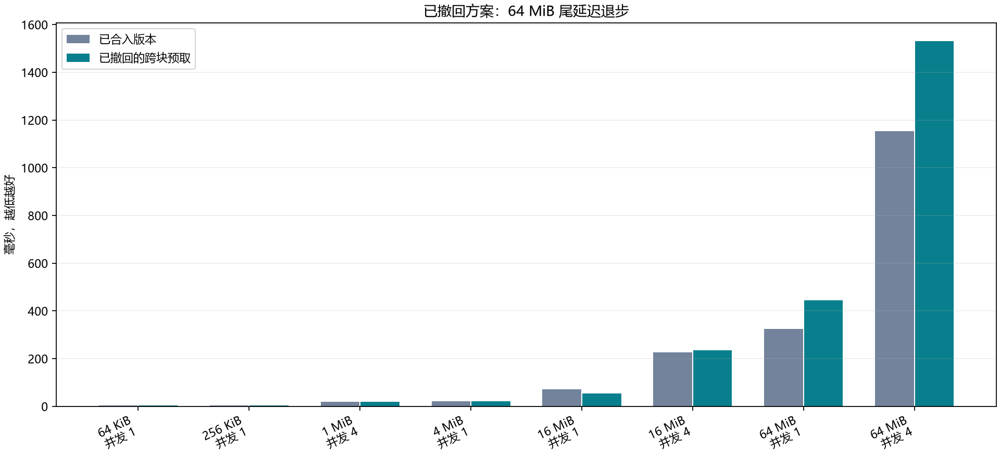
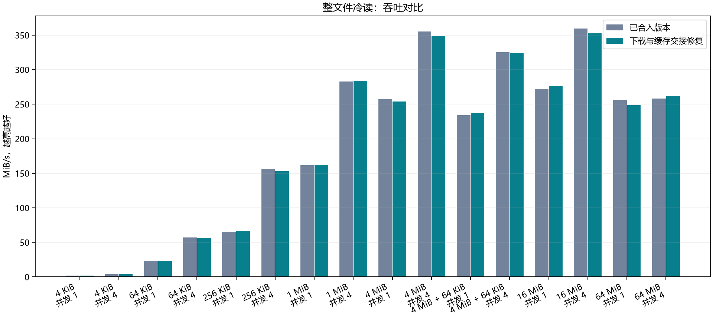
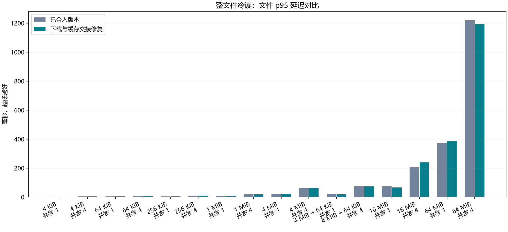
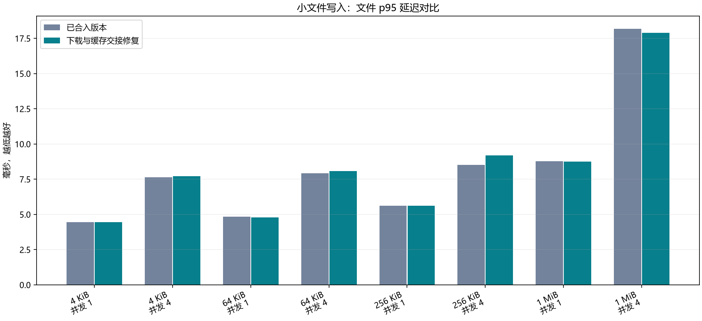
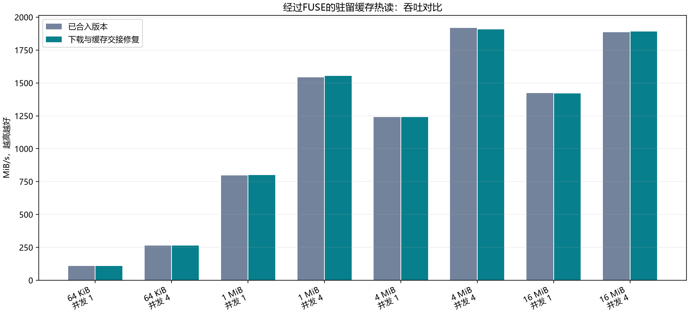

# Adverse-dimension maintenance — 2026-10-20

本次保留的是两处已经复现并验证的并发缺陷修复。**尚未通过全部性能门槛，不声称普遍提速或全部不利维度已经解决。** 比较基线是已合入的 `5c952b7`（运行代码 `687925b`），RustFS 固定为 `cc4926f`；auto hint 仍为最终编码对象不超过 1 MiB 时省略提示，更大对象请求 1 MiB EC。

## 修复的交接问题

完整对象下载原先先退出 SingleFlight，再复制数据并发布缓存。缓存发布遇到锁等待时，后来者既看不到正在执行的下载，也看不到缓存，会再发一次 GET；已有等待者还会重复插入同一缓存项。

现在成为下载发起者后重新检查缓存，将成功解码的非空对象发布到缓存后才结束合并请求。前台完整下载和范围读取触发的后台完整下载保持相同顺序；每个调用者分别检查自己的读取范围，缺失、损坏和越界读取仍报错。磁盘持久化保留原有机会式策略，没有增加长期结果缓存或新的自适应阈值。

回归测试持有真实缓存发布锁，在第一个下载完成后引入第二个读者：旧代码实际发出 **2 次 GET**，修复后为 **1 次**，并核对两位读者取得的字节及越界错误。ACS 整文件测试也观察到 16 MiB/并发 4 冷读的 GET 数从四轮 `65,64,64,65` 变为 `64,64,64,64`。

另一处修复在全局预取队列：取得第一个任务后，原代码再次等待 `recv_many`，孤立任务可能一直等待第二个任务。现在只通过有界 `try_recv` 收集已排队的任务；优先级、并发限制和去重保持原设计。独立测试验证只有一个任务时也能开始执行。

## 撤回的方案

连续 FUSE 片段触发下一块预取的候选已经撤回，没有留在 FileReader 或 BlockStore 策略接口中。独立两轮、36 组初筛中，16 MiB 单并发冷读吞吐增加约 18%，但 64 MiB 单并发/并发 4 文件 p95 分别增加约 39%/33%。完整结果见 [失败候选数据](evidence/adverse-prefetch-rejected.json)。

64 MiB 单并发的 settled GET 数两边每轮均为 128，平均 GET 耗时却从 11.95/11.19 ms 增到 14.63/13.21 ms。客户端没有 CPU 限流或内存配额耗尽。重复 GET 不能独自解释后段文件停顿，根因尚未完全确认。

## 实验标准和结果

杭州 ACS：BrewFS 4 核/8 GiB、RustFS 8 核/16 GiB、Redis 1 核/2 GiB，四块独立 40 GiB ESSD PL1，EC 2+2。4 MiB 文件系统块、读内存 64 MiB、读 SSD 关闭、写内存 64 MiB、写 SSD 1 GiB、总预算 512 MiB。两边使用同一服务、缓存预算和固定二进制；基线二进制直接复用。

主矩阵为 4 KiB、64 KiB、256 KiB、1 MiB、4 MiB、4 MiB+64 KiB、16 MiB、64 MiB 文件，线程并发 1/4，加一组 4 MiB/并发 4 混合读写，四轮按 AB/BA/BA/AB 顺序，共 136 组。全部通过真实 FUSE 挂载操作完整文件；冷读清空客户端挂载缓存，服务器/设备缓存不清空。

通过标准保持不变：配对吞吐比的 95% 区间下界 ≥0.95，文件 p95 比的区间上界 ≤1.05。明确提速还要求吞吐比 ≥1.05 且下界 >1。绝对值取各轮中位数，比例用同轮比值的几何平均；区间按整轮配对重采样计算。

| 测试内容 | 通过严格门槛 | 结论 |
|---|---:|---|
| 完整文件写入至阶段上传完成 | 9/16 | 部分吞吐和尾延迟区间仍未达标 |
| 客户端冷缓存完整文件读取 | 6/16 | 重复 GET 减少，仍没有明确吞吐提速 |
| 普通内核缓存热读 | 13/16 | 全部无 FUSE READ/S3 GET，不能归因于 RustFS |
| 完整文件混合读写 | 1/1 | 吞吐 +3.97%，区间 +0.82%～+7.40%；低于明确提速的 5% 门槛 |
| 经过 FUSE 的驻留缓存热读 | 8/8 | 四轮 64 组，性能基本持平，零新增 S3 GET |

主矩阵 49 项中 29 项通过、20 项未通过；没有统计上明确超过 5% 的退步，也没有符合明确提速标准的场景。**缺少明确退步证据不等于全部通过无回退验收。** 64 MiB 单并发冷读吞吐比为 0.969 [0.926,1.015]，p95 比为 1.076 [0.910,1.338]，仍须维护。256 KiB/并发 4 写入 p95 比为 1.077 [1.031,1.134]，也保留为不利结果。

写入吞吐计入阶段上传完成成本，并另存活跃期及严格清零等待后的指标。文件 p95 包含本次文件操作和 fsync，不表示单个文件远端上传完成时延。哈希检查在计时区间之外执行。驻留热读关闭 KEEP_CACHE，以 32 MiB 工作集分别重复完整读取 4/16/32 遍，要求存在 FUSE READ 且没有新增 S3 GET。

## 验证和证据边界

默认工作区 1190 项通过/225 项忽略，hint 工作区 1198 项通过/227 项忽略；9 项编译、格式和 Clippy 检查通过，包括 Tokio、io_uring 和 overlay 编译。7 项性能脚本检查沿用本轮已通过且源码未变的记录。这不代表重新通过 all-features 或完整 POSIX 测试。

236 组实验（失败初筛 36 + 主矩阵 136 + 驻留热读 64）分别保存，独立复核 82 项对比统计和 229,792 次完整文件哈希检查。热读第一轮结束后曾遇到 Kubernetes 观察连接失败；恢复时核对原进程、闭合结果和哈希，只继续未运行的组，没有重跑或拼接样本。另一次交付审计修正了热读重复遍数的校验假设，原始数据和统计门槛未变。

完整统计：[主矩阵](evidence/adverse-publication.json)、[驻留热读](evidence/adverse-resident-hot.json)、[独立审计](evidence/adverse-audit.json)。后续重点是 64 MiB 冷读尾延迟、部分小文件并发写入 p95，以及预取时后端竞争的可归因诊断；不要用重复跑到通过来替代原因分析。

独立交付物 `brewfs-adverse-maintenance/raw-records.tar.gz` 包含 3,932 个已逐项校验的文件，SHA-256 为 `ad764df184ae0e0647073efc67cb0652145f393d01797c297b1e78688029cc4a`。交付目录同时保留最终修复 `publication.patch`、冻结方案 `PUBLICATION.md`、失败候选 `candidate.patch` 和中文图表报告 `不利维度维护结果.html`。归档校验通过仅指证据完整性，不代表全部性能门槛通过。

受测修复版 BrewFS release 二进制 SHA-256 为 `dd5dc764d7e9155ec7f5e2bf2d1421c7cca3e0d54550e606cdc902fabd04e7c7`；复用基线为 `0b29553fa2cd5577c8eba9d03e9e1433a8da29e78e47c4894fcc44c728816b03`。构建后仅对测试函数签名运行 rustfmt，运行代码一致性另有回执，最终合入源码与归档的 `publication.patch` 一致。

原始记录导出并完成校验后，本轮专用 ACS 集群、四块 40 GiB 实验云盘及其 SLB/EIP 已删除，并通过云 API 核实。共享网络和其他任务的资源保留。删除记录随独立交付物保存，后续实验需要重新申请专用资源。
