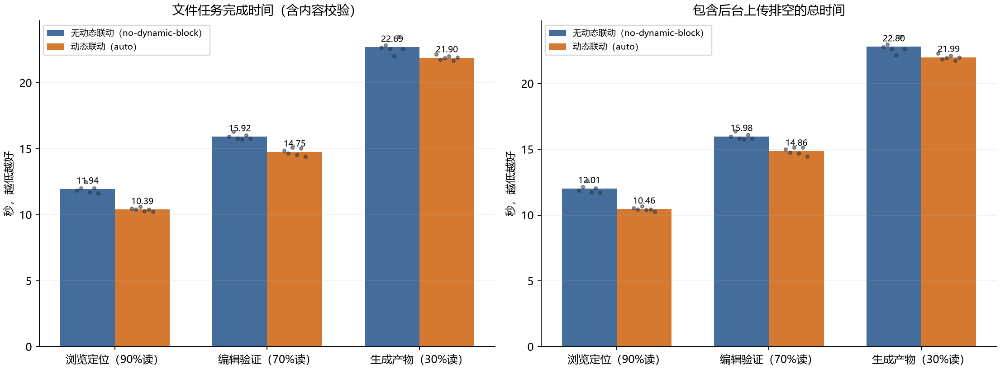
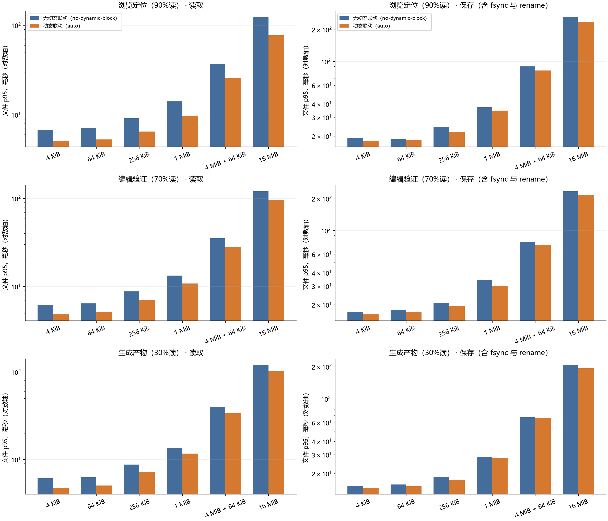
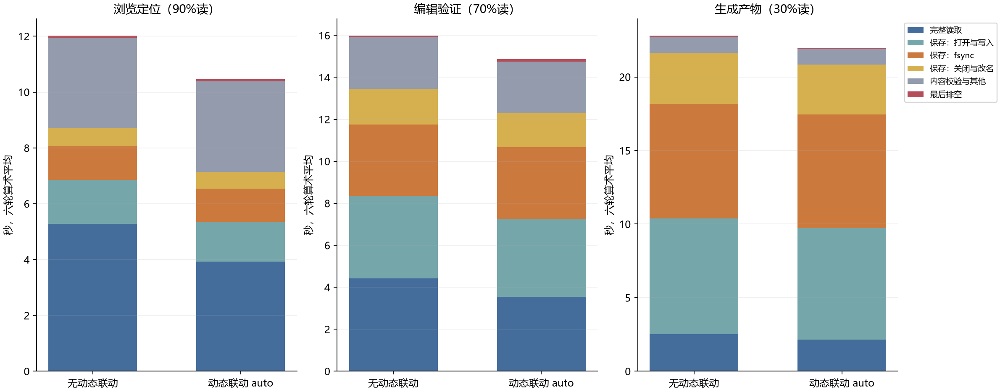
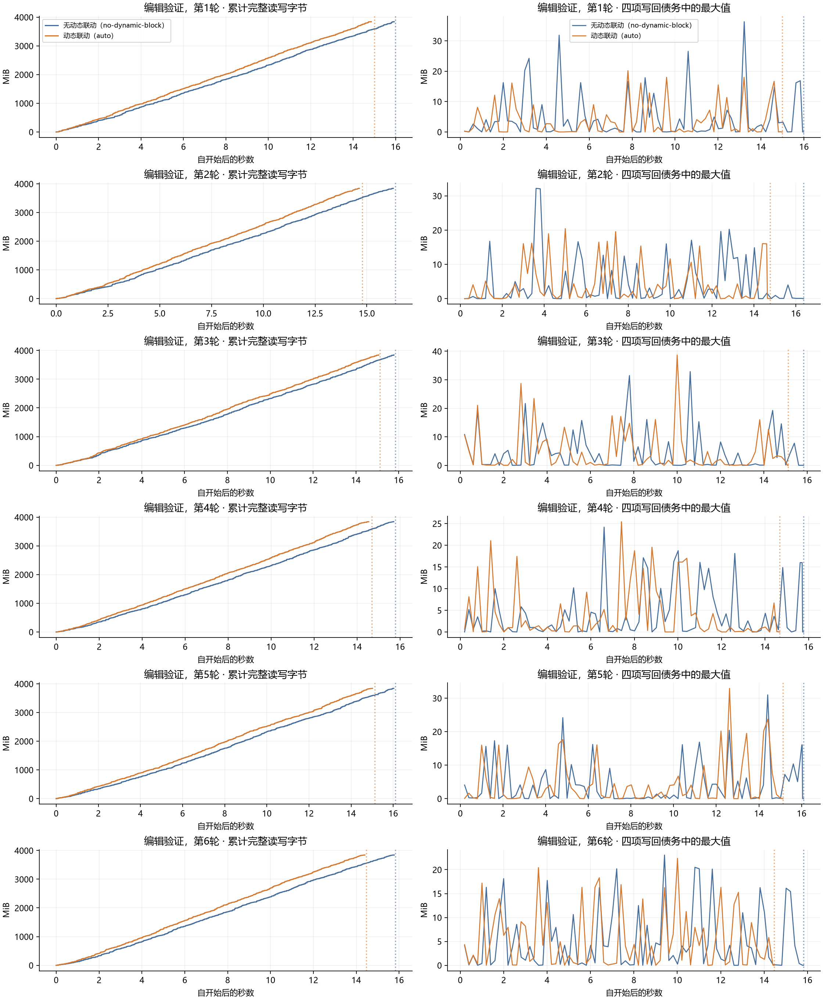

# Agent 混合文件读写：FUSE 端到端结果

2026-10-20。36 次正式运行和独立完整性核验已结束。**主场景吞吐有明确收益，整套性能验收尚未通过。**

## 三个场景，一个清楚的对照

应用直接访问 BrewFS FUSE 挂载目录。两组使用同一 BrewFS 和 RustFS 二进制；
`no-dynamic-block` 在运行时关闭 hint 及其整对象读取/LRU 联动，`dynamic-auto` 启用它们。
两组都编译了可选 feature，因此基线不是历史官方 RustFS，也不是未编译 feature 的版本。

BrewFS 分块仍为 4 MiB，chunk 为 64 MiB。auto 对最终编码对象 ≤1 MiB 不发 hint，
更大对象请求 1 MiB；本轮两组实际 EC 均为 1 MiB、q 均关闭。**这些结果证明当前整套
联动的端到端效果，不能证明改变 EC 块大小本身带来了收益。**

| 场景 | no-dynamic-block 总时间 | auto 总时间 | 有效吞吐变化 | 变化的 95% 区间 |
|---|---:|---:|---:|---|
| 浏览定位（90%读 / 10%写） | 12.01 秒 | 10.46 秒 | +14.9% | [+13.5%, +16.4%] |
| 编辑验证（70%读 / 30%写） | 15.98 秒 | 14.86 秒 | +7.5% | [+6.0%, +9.1%] |
| 生成产物（30%读 / 70%写） | 22.80 秒 | 21.99 秒 | +3.7% | [+1.9%, +5.9%] |

总时间包含完整文件读写、读后内容校验及最终上传排空；每组完成同样的工作量。
数字为六轮几何平均，区间以配对轮次计算。所有轮次、尾段和不利值都保留。

## 固定测试配置

- 四个 worker，每次 8,000 操作、3,842.5 MiB 逻辑 I/O，六轮配对，共 36 次。
- 同一轨迹内混合 4 KiB / 64 KiB / 256 KiB / 1 MiB / 4 MiB+64 KiB / 16 MiB 文件，
  操作占比分别为 40% / 30% / 15% / 10% / 4% / 1%。所有读写均覆盖完整文件。
- 预填充 3,000 文件后排空并重挂载。包含热点、共享只读、私有修改、创建和写后读。
  一半保存原子替换，一半创建；完整 write → fsync → close → rename。
- 应用请求上限 128 KiB；buffered FUSE，keep_cache=1，kernel writeback=false。
  单次应用请求与 4 MiB 数据块是不同层次，报告实际 FUSE 请求平均值，不虚构分布。
- 读/写内存各 64 MiB，读磁盘缓存 0，暂存容量 1 GiB，总预算 512 MiB，上传并发 3。
- 杭州 ACS：客户端通用型 4 CPU / 8 GiB，RustFS 性能型 16 CPU / 32 GiB，Redis
  1 CPU / 2 GiB，四块 40 GiB ESSD PL1；两组复用完全相同的资源。
- 原拟定的两种 16 核客户端 FUSE 设备预检失败，测量前改用已验证的 4 核客户端。
  客户端名义总出入带宽 1.5 Gbit/s；暂存为 /dev/vda5 上 ext4 emptyDir，物理介质
  未核实为本地 SSD。原失败预检、规格变更、环境容量检查均已归档。

这是合成的 agent 文件访问负载，不含模型推理和编译。前 128 KiB 内容随版本独立生成，
大文件尾部复用同大小档的不可变随机缓冲，但仍逐字节完整写入；压缩关闭，无后端去重。
完整读哈希不进入单文件 I/O 延迟，但进入总耗时。服务器/设备缓存未强制清空；
单次轨迹从客户端冷启动自然演化到热点读取，不把总结果叫作纯冷读或纯热读。

## 门槛与未通过项

吞吐比的 95% 区间下界至少 0.95；读/保存 p95 比区间上界最多 1.05。
主场景“编辑验证”的明确收益要求吞吐至少 +5%，且区间下界大于 1。
本轮 44/45 项强制性能门槛通过；编辑验证明确收益达标。
全部 51 项比较及每轮绝对值见 [统计原文](evidence/agent-mixed-analysis.json)。

- 浏览定位的整体保存 p95：42.819 → 41.247 ms，-3.7%；区间 [-13.0%, +7.3%]。
  点估计改善，但上界超过 +5%，属于无回退证据不足，不是已证实的回退。

各文件大小的读与保存 p95 均通过门槛。混合总体 p95 是混合样本的分位数，
不是各大小 p95 的平均；因此它与分档结果的统计判定可以不同。生成产物吞吐 +3.7%，
仍未达到预先规定的 +5% 明确收益幅度。不会通过追加同一候选的样本来改判。

## 关键瓶颈与下一步

读取收益较明显；写入比例升高后，总体收益缩小。最后完成 worker 的不重叠时间
分解如下。这里使用六轮算术平均，以保持各分段之和等于任务耗时。

| 场景（auto） | 总时间 | 保存全部阶段 | 其中 fsync | 完整读取 |
|---|---:|---:|---:|---:|
| 浏览定位（90%读 / 10%写） | 10.458 s | 3.218 s | 1.195 s | 3.929 s |
| 编辑验证（70%读 / 30%写） | 14.863 s | 8.744 s | 3.411 s | 3.547 s |
| 生成产物（30%读 / 70%写） | 21.990 s | 18.705 s | 7.747 s | 2.141 s |

独立的 edit/auto syscall 诊断确认 4,800 次 fsync、278,270 次 openat、278,005 次 close、
446,147 次 read。该诊断不属于 36 次正式数据；插桩改变时序，跨线程累计等待也不能
当作任务时间。readv 中包含 FUSE 接收线程等待请求，不能依据其占比宣称 CPU 瓶颈。

源码还显示一个待核实的调用放大来源：`writer.rs` 在当前 inode 没有内存 writer 时，
只用全局 `has_recoverable_data()` 进入恢复回退；`write_back.rs` 随后遍历 dirty 目录并
读取元数据，再按 inode/chunk 过滤。因此其他文件正在写回时，读取只读上下文也可能
扫描这些文件。当前 syscall 汇总没有路径，不能把全部打开次数归因于此。

后续顺序保持简单：

1. 单独采样这些文件调用的路径，确认恢复扫描在正常混合负载中的占比。
2. 若证实，先验证按 inode/chunk 限定恢复扫描范围，保留崩溃恢复与并发读写语义。
3. 另一个独立候选是将同一次暂存的 open/seek/write/同步放在一次 blocking 调度内；
   文件与目录 sync_all、偏移写、不截断和错误传播语义必须保留。两个候选不捆绑。
4. 仍用相同三场景和六档混合文件。先与当前 auto 比较，再展示 no-dynamic-block
   对照；必要时补配对基线，已有原始结果保留，不扩展主结果的配置矩阵。

本轮没有修改或接受新的产品性能代码。接受下一候选前仍须通过仓库当前 Rust CI
与 compose 混合读写/direct=0/1 回归守卫；本报告不冒充这些尚未进行的验证。

## 可追溯性

- BrewFS 运行代码 7d3c366，方案提交 0aeda89；二进制 SHA-256
  `dd5dc764d7e9155ec7f5e2bf2d1421c7cca3e0d54550e606cdc902fabd04e7c7`。
- RustFS cc4926f；二进制 SHA-256
  `dc5e70da04d904f5ba3ec114776eb680551a2554107b36e5521393d80a9ffc9b`。
- 288,000 操作、182,400 即时完整读校验、160,800 重挂载完整文件校验、108 次
  正常挂载退出、914,208 份物理布局核验全部通过。正确性与性能结论分别判断。
- 管理接口两次超时及一次 EOF，分别影响第 22/30/33 组的观察或布局审计。
  远端原作业独立完成并接回，未重跑、截短或拼接测量。原错误和恢复记录保留。
- 原始归档 `brewfs-agent-mixed/raw-records.tar.gz` 共 1,816 个已核验文件；
  SHA-256 `ba27d32e7634ba83503084259f350a136acb313406593063ab0791397131ec3c`。归档独立交付，包含 frozen tools、
  输入轨迹、各轮原始操作、诊断和失败记录；产品仓库只保存汇总及指纹。
- 凭据、kubeconfig 和二进制不在归档内。最终导出后删除本轮专用资源，
  删除核验见同一交付目录的 `cleanup-complete.json`，共享网络保留。

