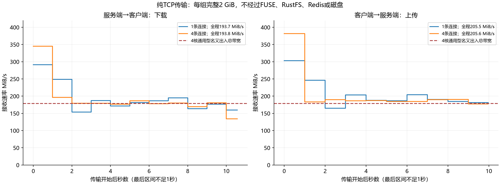
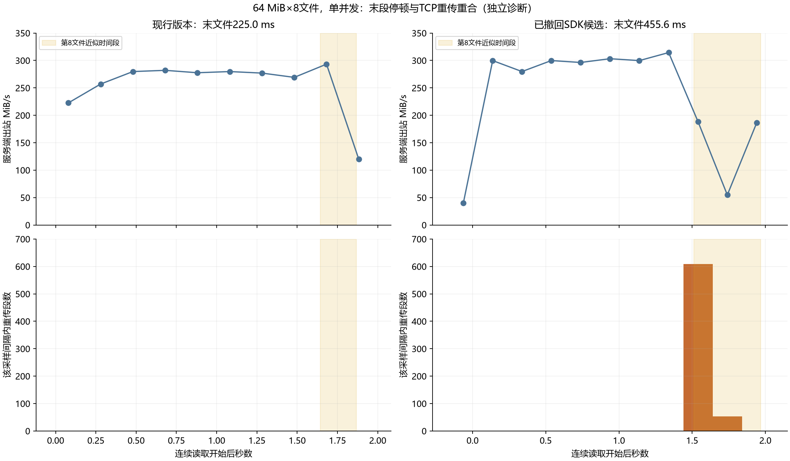
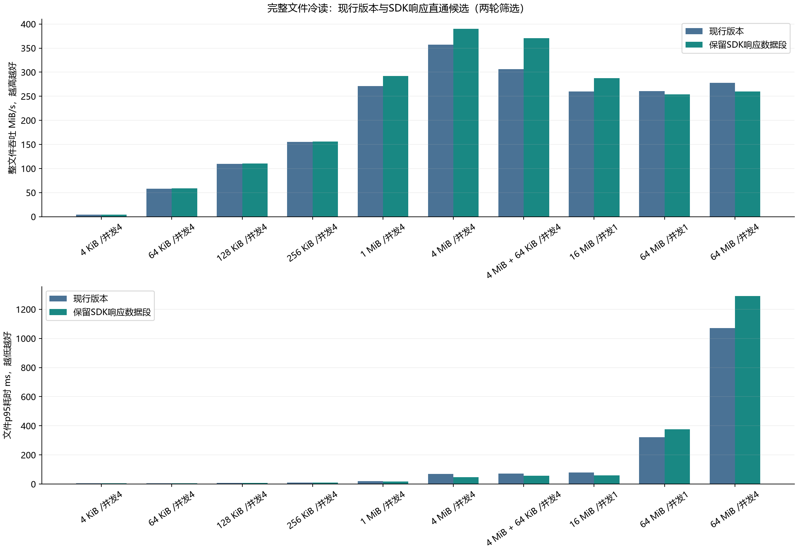

# Bottleneck attribution — 2026-10-20

目标是继续修复写入、冷读、驻留热读和混合读写的不利维度。本轮找到了
**小文件上传队列、客户端响应收集成本，以及持续大文件测试的传输瓶颈**。
四个性能候选都没有通过完整门槛，均已撤回；没有合入新的性能实现。

基线 BrewFS 为 `7d3c366`，固定 RustFS 为 `cc4926f`。本轮只在独立杭州
ACS 环境运行测试，WSL 用于编译与分析；复用已有基线二进制。此前已接受的
缓存发布/SingleFlight 修复仍保留，详见 [上一轮维护](adverse-maintenance.md)。

## 首要发现：大文件测试已经遇到传输限制

实际 Pod 为通用型：BrewFS 4核/8 GiB，RustFS 8核/16 GiB，Redis 1核/2 GiB。
[ACS 官方规格](https://help.aliyun.com/zh/cs/user-guide/acs-pod-instance-overview)
在2026-10-20核对时，规定4核、8核的出入总带宽分别为1.5、2.5 Gbit/s。
4核档约为178.81 MiB/s，尚未扣除协议开销。

独立纯TCP对照在同一对Pod中传输内存数据，绕过FUSE、BrewFS、RustFS、
Redis和磁盘。每组完整2 GiB，共8 GiB，10条数据流全部通过SHA256校验。

| 测试内容 | 连接数 | 完整2 GiB耗时 | 全程吞吐 | 第2秒后吞吐 | 发送端重传 / 超时 |
|---|---:|---:|---:|---:|---:|
| 服务端→客户端下载 | 1 | 10.570秒 | 193.75 MiB/s | 175.95 MiB/s | 15,896 / 18 |
| 服务端→客户端下载 | 4 | 10.568秒 | 193.79 MiB/s | 175.87 MiB/s | 50,253 / 89 |
| 客户端→服务端上传 | 1 | 9.968秒 | 205.45 MiB/s | 188.05 MiB/s | 10,348 / 15 |
| 客户端→服务端上传 | 4 | 9.963秒 | 205.57 MiB/s | 186.30 MiB/s | 42,031 / 52 |

增加连接数几乎没有提高持续吞吐，却显著增加重传。第2秒后数值只是完整
曲线的分段描述，全程结果包括所有首段和尾段；没有删除慢样本。曲线基于
8 MiB接收进度插值得到，最后不足1秒的区间也保留。接收端SHA256在计时内，
累计进程CPU约6.4～9.8秒，整组约10秒；每个场景只有一次独立诊断，没有
性能置信区间。这证明传输平台现象不依赖对象存储或文件系统，但尚未确定
具体哪个网络层丢包，不能把全部原因归为某个内核参数。

真实BrewFS连续读也观察到对应关系：64 MiB×8文件，单并发时，SDK候选
前7文件约208～228 ms，最后文件455.64 ms；服务端662次重传集中在约
1.44～1.84秒。现行版该场景没有重传，末文件224.97 ms。并发4时两边均有
后段停顿，重传分别976/2245次。两边CPU配额限流计数为零；服务端相应
冷读阶段内存不足6.2 GiB/16 GiB，无重缺页，不能推断是缓存内存已满。

这6组文件诊断共1,088次完整哈希；正常连续读法、计时结束后再哈希的内存
保留方式与失败筛选相同。服务端200 ms采样按客户端UTC包围，含边界流量
和潜在时钟偏差；计数覆盖网络命名空间。末文件位置为顺序耗时累计近似。
它们用于定位，不能推翻失败筛选或作为新候选接受结果。

## 已证实的代码成本与撤回原因

S3适配器将SDK响应转换为AsyncRead，再经默认4 KiB ReaderStream重新分段。
收集器每段精确扩容。真实FUSE读挂载读取8个64 MiB文件时出现13,795次
`mremap`，写挂载为零。保留SDK数据段的候选将该计数降至355次；另一组
逐文件诊断中，首文件耗时289.22→222.11 ms、BrewFS累计CPU
249.15→168.96 ms。这些是独立机制诊断，文件之间停150 ms且立即哈希释放；
不能替代正常连续读取结果，也不能据此宣称内存复制次数已被证明。

两轮AB/BA的正常筛选结果如下，所有文件完整读写：

| 冷读场景 | 现行版→SDK候选 | 吞吐变化 |
|---|---:|---:|
| 1 MiB / 并发4 | 271.05→292.29 MiB/s | +7.8% |
| 4 MiB / 并发4 | 357.15→390.41 MiB/s | +9.3% |
| 4 MiB+64 KiB / 并发4 | 306.00→370.64 MiB/s | +21.1% |
| 16 MiB / 单并发 | 260.32→287.43 MiB/s | +10.5% |
| 64 MiB / 单并发 | 260.62→253.63 MiB/s | -2.6%，未通过 |
| 64 MiB / 并发4 | 277.61→259.83 MiB/s | -6.4%，明确退步 |

64 MiB/并发4的文件p95由1070.52→1291.36 ms，增加20.6%；混合读写
等未通过项也完整保留。SDK候选已撤回，冻结的184组正式计划和fio守卫没有
运行。网络诊断不撤销这一决定。

小文件方面，同一二进制仅增加上传重叠，64 KiB/并发4写入可由24.61提升至
36.82 MiB/s，但单次PUT反而变慢。统一3→6、不超过1 MiB轻权重、仅不超过
64 KiB轻权重，三个候选都出现写入或冷读尾延迟退步，均已撤回。收益属于
上传排队重叠，不能记作auto hint数值的收益。

## 标准、证据和剩余工作

写入计入观测到的上传完成，并另报严格债务清零；文件p95包含open到
fsync/close，不代表每个文件的远端持久化p95。冷读重挂载客户端，服务端
与设备缓存不清空。驻留热读须FUSE READ>0、S3 GET=0；普通内核热读单列。
吞吐95%区间下界≥0.95、文件p95比上界≤1.05；明确收益还需吞吐≥5%且
下界>1。按轮配对统计，每个阶段独立，不拼接筛选与正式样本。

5个主阶段共236组、151项比较、245,312次完整文件哈希，全部原始结果保留。
另有基线归因416次、候选机制144次、网络归因1,088次完整文件哈希，纯TCP
10次完整数据流哈希分别记录。SDK候选的默认工作区1192项通过/225项忽略，
hint工作区1200项通过/227项忽略；9项编译/lint与7项脚本检查通过。这些是
已否决候选的正确性证据，不代表新的已接受实现、all-features或完整POSIX。

下一轮优先顺序：

1. 在带宽更充足的ACS规格先验证持续双向传输能力。记录CPU型号、资源预算
   与实际Pod规格；如果硬件同时变化，标为整体部署对照。
2. 在同一新拓扑内配对现行版与最小响应收集候选。基线二进制复用，仅补测
   新环境下必要的基线。旧环境失败结果保留，资源升级收益单列。
3. 拆分小文件stage中的本地持久化、封口和Redis提交，再决定是否改上传调度；
   保留提交前落盘与严格排空，不同时修改块大小和预取。
4. 继续以驻留热读、混合读写和compose direct=0/1作为守卫；完整大文件增加
   至少2 GiB持续流量，同时报告首段突发与后段，而不删除后段。

证据入口：[本轮清单](evidence/bottleneck-delivery.json)、
[SDK完整筛选](evidence/bottleneck-body-stream-screen.json)、
[网络诊断](evidence/bottleneck-network.json)、
[纯TCP结果](evidence/bottleneck-transport.json)。本轮专用集群、四块40 GiB盘、
SLB/EIP已确认删除，实验凭据已移除。一个专用安全组仍因云平台报告实例
依赖而无法删除，12次有限重试失败；关联ECS、网卡、ECI查询为空，共享
VPC、交换机和NAT确认保留。残留如实记入清单，后续待依赖释放再删除。
未开展新环境验收，性能维护目标仍未完成。
