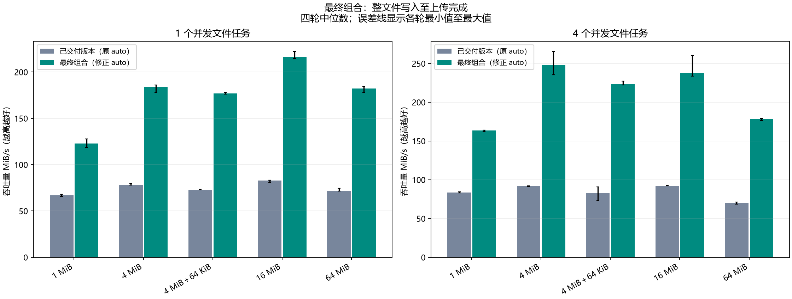
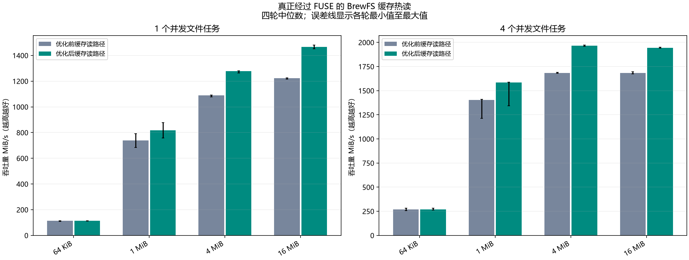
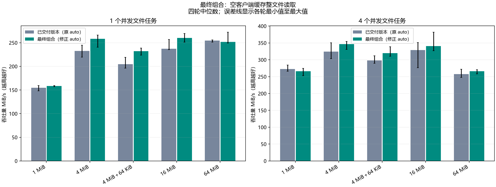
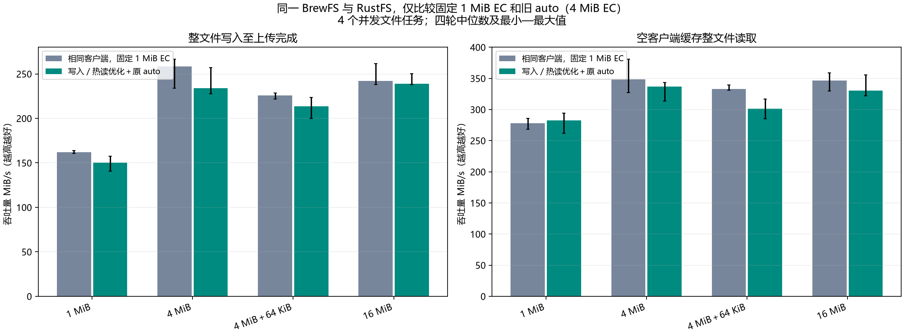
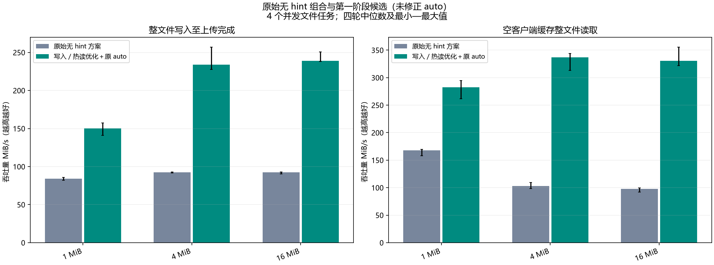

# Evaluation: filesystem workloads on ACS

## 测试的是 BrewFS

应用对真实挂载目录执行 `open → write → fsync → close`，再完整读取文件。请求经过 Linux FUSE、BrewFS VFS/缓存/后台上传、Redis 元数据和 RustFS S3 服务。HTTP 上传/HEAD/GET 是辅助的协议正确性检查。本轮不是绕过 BrewFS 直接压 RustFS 接口后推算文件系统性能。

| 项目 | 固定条件 |
|---|---|
| 运行地点 | Aliyun ACS，杭州；本地 WSL 仅编译 |
| BrewFS | 4 CPU / 8 GiB；4 MiB 数据块；读写内存预算各 64 MiB |
| 暂存与压缩 | SSD writeback 1 GiB；读 SSD 缓存关闭；不压缩 |
| RustFS | 8 CPU / 16 GiB；四块独立 40 GiB ESSD PL1；2 data + 2 parity |
| 元数据 | 独立 Redis 实例 |
| 文件大小 | 4/64/256 KiB、1/4 MiB、4 MiB + 64 KiB、16/64 MiB |
| 并发 | 1 或 4 个文件任务；另测 4 MiB、并发 4 的整文件混合读写 |
| 冷读 | 卸载后以新缓存目录重挂；只清空客户端缓存，服务器/云盘缓存保留 |
| 普通热读 | 正常 KEEP_CACHE；可由内核页缓存直接完成 |
| BrewFS 缓存热读 | KEEP_CACHE=0；32 MiB 工作集放入 64 MiB 缓存；必须有 FUSE READ、无新增 S3 GET |

写入同时保留前台、远端上传完成、全部 dirty/pending/inflight 清零三种耗时，主吞吐使用上传完成口径。文件 p95 是文件操作延迟，不包含整批操作后额外的清债时间。完整哈希和磁盘布局检查在计时之外。

## 对照及统计标准

| 阶段 | 组数 | 比较目的 |
|---|---:|---|
| 写入初筛 | 20 | 定位上传完成后写预算仍滞留 |
| 已撤回的调度热读初筛 | 32 | 只有约 1% 变化，未保留代码 |
| 共享回复初筛 | 32 | 检查实际经过 FUSE 的缓存收益 |
| 第一阶段正式对照 | 184 | 同旧 auto 隔离客户端改动；补充原版及固定 1 MiB EC 对照 |
| 独立缓存热读确认 | 64 | 两边均已修复写预算，只改变共享回复 |
| 修正 auto 的正确性检查 | 3 | 不混入正式计时统计 |
| 最终组合确认 | 88 | 已交付 e5fec71 对最终 687925b；1–64 MiB 受影响尺寸及混合读写 |

正式阶段各有四轮平衡顺序，按同轮同场景配对。使用吞吐比的几何平均，枚举四轮有放回抽样的 256 种组合计算 95% 区间。表中的绝对吞吐为四轮中位数，不能用两个中位数相除代替配对比值。

- **明确吞吐提升**：比值 ≥ 1.05，且区间下界 > 1。
- **完整无明显回退门槛**：吞吐比区间下界 ≥ 0.95，文件 p95 比区间上界 ≤ 1.05。
- 未通过仍保留；区间过宽不自动等于已经证明回退，也不允许将其算作通过。
- 不拼接不同阶段的样本，不将阶段间倍率相乘。原版二进制复用，最终策略没有重复采集原始无 hint 组合。

## 最终组合：写入

相对已交付 `e5fec71`，10/10 场景明确提升并通过完整门槛，配对吞吐为 **1.838–2.722 倍**。全部清债口径同样改善。

| 文件大小 | 并发 | 之前 MiB/s | 之后 MiB/s | 配对吞吐比 |
|---|---:|---:|---:|---:|
| 1 MiB | 1 | 66.98 | 122.94 | 1.838 |
| 1 MiB | 4 | 83.45 | 163.58 | 1.954 |
| 4 MiB | 1 | 78.39 | 183.87 | 2.325 |
| 4 MiB | 4 | 91.60 | 248.20 | 2.715 |
| 4 MiB + 64 KiB | 1 | 73.03 | 177.01 | 2.423 |
| 4 MiB + 64 KiB | 4 | 83.20 | 222.99 | 2.722 |
| 16 MiB | 1 | 82.74 | 215.99 | 2.636 |
| 16 MiB | 4 | 92.29 | 237.82 | 2.623 |
| 64 MiB | 1 | 71.72 | 182.38 | 2.513 |
| 64 MiB | 4 | 69.84 | 178.75 | 2.550 |

混合读写的配对比为 **1.062**，吞吐中位数 289.01 → 312.41 MiB/s，通过完整门槛。

## 真正的 BrewFS 缓存热读

8/8 场景通过完整门槛，6/8 明确提升。64 KiB 基本持平，1–16 MiB 文件提升约 **10.8%–20.0%**。每次重复读取均有 FUSE READ 且无新增 S3 GET，收益来自客户端缓存路径。

| 文件大小 | 并发 1 的提升 | 并发 4 的提升 |
|---|---:|---:|
| 64 KiB | 0.9% | 0.9% |
| 1 MiB | 10.8% | 12.4% |
| 4 MiB | 17.3% | 16.8% |
| 16 MiB | 20.0% | 15.5% |

最后 auto 修正没有改变七个写入/热读源文件，逐字节一致；这些热读既不发 S3 GET，也不重新解码对象，可以保留该独立证据。普通内核热读则可能不进入 BrewFS，不能冒充这组实验。

## 冷读、普通热读与小文件限制

最终冷读 5/10 达到明确吞吐提升，6/10 通过完整门槛；全部吞吐比为 0.969–1.126。未通过为：1 MiB/并发 4、4 MiB/并发 1、16 MiB/并发 4、64 MiB/并发 1。没有被区间支持的明确回退，不等于证明这些场景无回退。

最终普通内核热读 7/10 通过，未通过为 16 MiB/并发 4、64 MiB/并发 1 和 4；没有达到既定标准的明确提升。第一阶段 64 KiB/并发 1 与 256 KiB/并发 1 写入也没有通过完整门槛，保留在完整比较数据中。不能用大文件结果宣称所有小文件都更快。

## 为什么保留 1 MiB EC

第一阶段使用相同新客户端、同一 RustFS、相同完整 GET 与缓存策略，仅改变 EC 提示。旧 auto 4 MiB 没有明确读写收益；4 MiB + 64 KiB/并发 4 的冷读相对固定 1 MiB 为 **0.901**，区间 **[0.874, 0.925]**。两边每轮都是 2176 次 FUSE READ、128 次 S3 GET，不能把差异归于下载合并。

这组不利结果促使 auto 改为大对象明确请求 1 MiB。当前收益主要由完整 GET 合并、缓存准入、写预算释放、共享回复和已固定的 RustFS 读路径共同提供；不是更大 EC 块的普遍优势。

## 原始无 hint 组合对照的边界

第一阶段原始对照为 BrewFS `de77445` 不配置 hint + 原始 RustFS `7147063`；候选为写/热读优化 + RustFS `cc4926f`，仍使用旧 4 MiB auto。六个写入场景为 **1.781–2.636 倍**，六个客户端冷读场景为 **1.574–3.455 倍**，均通过完整门槛。

这是组合效果，不能全部归因于本轮修改或 hint 数值；也不是最终修正 auto 与原版的直接同轮对照。避免重复基线是本轮明确约束。

## 正确性、归档与未覆盖范围

最终默认功能 lib/bin 测试 1188 通过、225 跳过；hint 配置 1196 通过、227 跳过，均无失败。九项编译/格式/clippy/运行时/overlay 编译检查、七项性能脚本检查通过。历史 all-features/overlay/operator 全套检查曾有未解决失败，本轮不能改称全仓库所有 CI 已通过，详情见 [维护说明](maintenance.md)。

全部 423 组保留，共 289,740 次完整文件哈希检查、470,584 条四盘元数据布局检查。7,499 个归档文件哈希校验通过；120 项配对比较独立重算通过。资源记录没有 CPU 配额限流或内存分配失败。控制端 TLS 超时只恢复观察与导出，未重跑样本；第二轮结束后在服务停止、旧阶段记录归档校验的条件下回收临时对象，未与计时重叠。

本次确认没有覆盖九轮通用验收、压缩性能、动态改变 BrewFS 数据块边界、MinIO、其他盘规格/集群规模或所有历史 SPEC。全部本轮临时 ACS 计算和存储资源已清理，四块实验云盘已通过阿里云接口确认删除。
